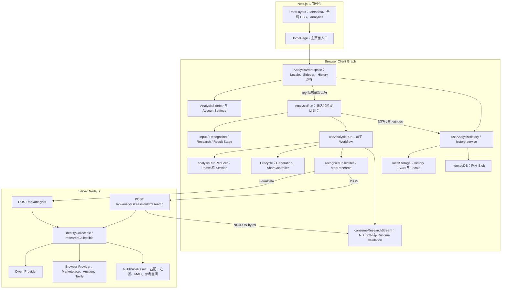
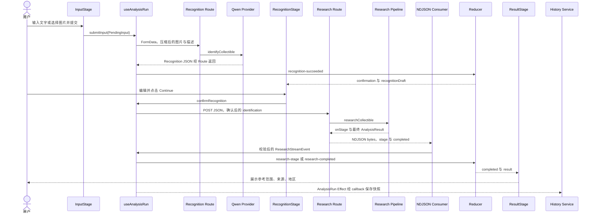
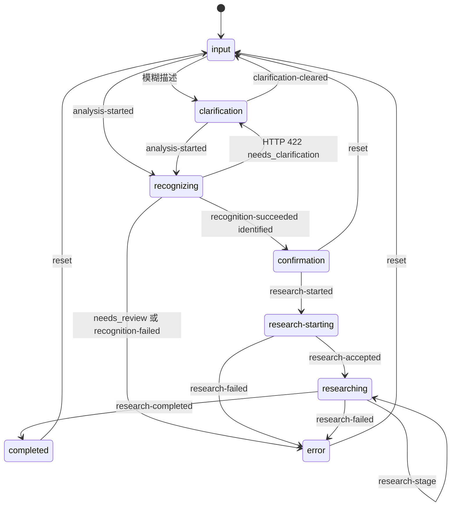

# Curio Frontend Architecture — 日本新卒技术面试学习文档

## 阅读范围与证据约定

分析日期：2026-10-11。实际工作目录：`D:/github/Curio`；本地 Branch：`refactor/frontend-architecture`；HEAD：`02ee449`。**分析对象是当前工作树，包含已有未提交修改，不是远端 master，也不是此前的 sanitized copy。** 行号对应本次读取的版本，后续修改后可能变化。

本轮只进行代码、配置和测试源码的静态检查；不运行应用、外部 API、安装、Build 或测试，不宣称真实 E2E、部署或测试通过。现有代码与旧文档有差异时，以现有代码为准。本文不判断代码是谁写的，也不推断开发者当初的主观动机。

- **事实**：能从当前文件、函数和调用关系直接确认。
- **合理解释**：这种设计能够带来的技术收益，不等于“我当初就是这样考虑的”。
- **限制 / 待验证**：静态代码暴露的边界，或需要浏览器 / 真实环境才能确定的行为。
- 所有 `src/...`、`tests/...` 路径均相对于上述实际仓库；链接指向完整本地路径。`L` 表示源码行号。

先记住一句话：**Curio 是 Next.js App Router 应用；浏览器端围绕单次分析流程组织 UI，用 Custom Hook 编排异步操作、Reducer 管理阶段；Server 完成 AI 识别、Marketplace 研究和价格计算；浏览器本地保存历史。** 不是 Redux 应用，不是后台持久任务队列，也不是有账号同步的聊天系统。

## 一、先看架构图

这是逻辑模块图，不代表每个方框都是独立部署的服务。React 的 Render / Props 关系与 HTTP 边界分别标出。



证据：`src/app/layout.tsx::RootLayout` L17、`src/app/page.tsx::HomePage` L3；`src/features/analysis/components/analysis-workspace.tsx::AnalysisWorkspace` L10/L54；`hooks/use-analysis-run.ts::useAnalysisRun` L46；`src/server/analysis/run-pipeline.ts::identifyCollectible / researchCollectible` L30/L49。浏览器不会直接调用 Qwen / Browserless。

## 二、核心模块职责速查表

“适合这个层级”是合理技术解释，不是历史开发动机。阶段文件里有局部组件，不必把每个组件都拆成独立文件。

### 2.1 页面、组件与展示层

| 实际 File / 关键函数 | Responsibility | 输入 | 输出 | 主要依赖 | 层级理由 | 修改影响 |
|---|---|---|---|---|---|---|
| [src/app/layout.tsx](D:/github/Curio/src/app/layout.tsx:17) `RootLayout` | 公共 HTML、Metadata、字体、CSS、Analytics | `children: ReactNode` | 页面外壳 | Geist、Analytics | 路由共享设施 | 所有页面、首屏 |
| [src/app/page.tsx](D:/github/Curio/src/app/page.tsx:3) `HomePage` | `/` 入口 | 无业务 Props | `main` + Workspace | AnalysisWorkspace | 路由不承担 Workflow | 主页面入口 |
| [components/analysis-workspace.tsx](D:/github/Curio/src/features/analysis/components/analysis-workspace.tsx:10) `AnalysisWorkspace` | Locale、Sidebar 开关、历史选择、Run 身份 | 无 Props | Sidebar + keyed Run | History Hook、Locale Service | 跨运行 UI 放公共父级 | Sidebar、所有 Stage、历史切换 |
| [components/analysis-run.tsx](D:/github/Curio/src/features/analysis/components/analysis-run.tsx:47) `AnalysisRun` | 输入草稿、图片预览、阶段组合、History 保存 Effect、语音入口 | Locale、历史、保存 / Busy callbacks | 当前单次分析界面 | Run Hook、四个 Stage、History Image Service | 一次运行的容器 | 全 Workflow 和图片生命周期 |
| [components/input-stage.tsx](D:/github/Curio/src/features/analysis/components/input-stage.tsx:260) `InputStage / ProductInput` | 受控输入、提交、上传入口、文本框尺寸 | 输入值、选项、UI flags、callbacks | 表单；`PendingInput` callback | uiCopy、Radix、DOM refs | 输入表现与业务请求分离 | 输入体验、PendingInput |
| 同文件 L38/L57/L91 `CategorySelector / CollectorModeToggle / ImageUploader` | 分类、模式开关、文件选择与预览 | 父级 Props 的子集、DOM refs | 局部 UI、变化 callbacks | `Pick`、uiCopy、Radix | 内聚的局部组件，无独立网络职责 | InputStage；不是独立文件 |
| [components/recognition-stage.tsx](D:/github/Curio/src/features/analysis/components/recognition-stage.tsx:28) `RecognitionStage` | 展示与编辑商品身份、人工确认 | `DetectionResult`、status、图片、evidence、泛型 callbacks | 受控字段；Continue callback | 分类常量、uiCopy、useRef | 不接触 fetch 与价格计算 | 确认数据、后续 Research 参数 |
| [components/research-stage.tsx](D:/github/Curio/src/features/analysis/components/research-stage.tsx:70) `ResearchStage` | 显示当前研究阶段 | status、message、Locale、CollectorMode | 进度 UI | `ResearchProgress / ResearchStatusMessage / ResearchSourceStatus` | 只解释传入状态 | Loading / 步骤显示，不启动请求 |
| [components/result-stage.tsx](D:/github/Curio/src/features/analysis/components/result-stage.tsx:144) `ResultStage` | 参考价格、拍卖信号、地区、来源、活动列表 | `AnalysisResult`、`ToolActivity[]`、Locale | 结果 UI、外链 | uiCopy、formatYen、mapsUrl、activityCopy | 展示结果而不重算业务规则 | 价格 / 来源解释、结果准确性 |
| [src/components/ui/analysis-sidebar.tsx](D:/github/Curio/src/components/ui/analysis-sidebar.tsx:22) `AnalysisSidebar` | 历史搜索、选择、删除、导航 | History、active ID、展开状态、callbacks | Sidebar；操作 callbacks | AccountSettings、Radix、uiCopy | 导航与一次分析解耦 | History 入口、移动端导航 |
| [src/components/ui/account-settings.tsx](D:/github/Curio/src/components/ui/account-settings.tsx:13) `AccountSettings` | Guest 设置 Dialog、语言、固定 Tokyo | Locale、onLocaleChange、disabled | 原生 dialog + Select | SettingsDropdown、HTMLDialogElement ref | 设置表现层 | 语言与 Dialog；不代表有账号系统 |
| [src/components/ui/settings-dropdown.tsx](D:/github/Curio/src/components/ui/settings-dropdown.tsx:8) `SettingsDropdown` | 通用受控 Select、Dialog 内 Portal | string value、options、callback | Radix Select | useState、callback ref、Radix | 可复用 UI Primitive 包装 | 设置菜单和 Portal 容器 |
| [src/components/analytics.tsx](D:/github/Curio/src/components/analytics.tsx:6) `Analytics` | 按公开 ID 注入统计脚本 | 环境中公开 measurement / project ID | `next/script` 或 null | Next Script | Layout 级横切设施 | 第三方脚本、隐私 / CSP；是否启用未检查 |
| [src/components/ui/language-switcher.tsx](D:/github/Curio/src/components/ui/language-switcher.tsx:18) `LanguageSwitcher` | 独立语言按钮组 | Locale、placement、disabled、callback | 按钮组 | UiLocale | 可复用旧组件 | 当前 `src` 未找到导入；不是主页面入口 |
| [src/components/ui/brand.tsx](D:/github/Curio/src/components/ui/brand.tsx:7) `Shell / Brand` | 旧品牌、页头页脚 | children、className | shell | next/link | 外壳组件 | 当前 `src` 未找到 Shell 导入 |
| [components/analysis-view.tsx](D:/github/Curio/src/features/analysis/components/analysis-view.tsx:10) `AnalysisView` | 静态 Session 展示，包括 warnings | `AnalysisSessionView` | 展示 UI | 共享类型 | 目前供 Dev Gallery 使用 | 不等于生产 ResultStage；两套展示会漂移 |
| [src/app/dev/analysis-states/page.tsx](D:/github/Curio/src/app/dev/analysis-states/page.tsx:8) `AnalysisStatesPage` | 开发环境状态图库 | fixture state | AnalysisView 集合 | fixtureSession、notFound | 调试展示而非真实任务 | 生产环境直接 notFound |

上表 `components/...` 的完整前缀为 `src/features/analysis/`。没有 `input/recognition/research/result` 四级子文件夹；也没有独立的 `PriceSummary.tsx / MarketplaceListings.tsx / RecognitionActions.tsx`。名称类似的职责目前在对应 Stage 的 JSX / 局部函数中。

### 2.2 Hooks、State、Services、Storage 与共享模块

| 实际 File / 关键函数 | Responsibility | 输入 | 输出 | 主要依赖 | 层级理由 | 修改影响 |
|---|---|---|---|---|---|---|
| [hooks/use-analysis-run.ts](D:/github/Curio/src/features/analysis/hooks/use-analysis-run.ts:46) `useAnalysisRun` | 请求编排、状态转换、异常与 stale guard | Locale、initialHistory、promote callback | flags、draft、result、操作函数 | Reducer、Lifecycle、API Services、Stream Hook、压缩 | React 生命周期与纯逻辑的连接 | 全 Workflow |
| 同文件 L23 `createAnalysisSession` | Recognition DTO → UI Session | RecognitionResponse、PendingInput、时间 | id + AnalysisSessionView | 共享类型 | 可独立测试的 Adapter | 新旧 runId / sessionId 兼容 |
| [hooks/use-research-stream.ts](D:/github/Curio/src/features/analysis/hooks/use-research-stream.ts:7) `useResearchStream` | 将 Stream Consumer 包装为 callback | 默认 onEvent | `(stream, options) => Promise<void>` | consumeResearchStream、useCallback | 薄 React Adapter | 流消费入口；本身不持有 State |
| [hooks/use-analysis-history.ts](D:/github/Curio/src/features/analysis/hooks/use-analysis-history.ts:12) `useAnalysisHistory` | 历史 State、读取、保存、切换、删除 | 无 Props | history、load status、selected、key、操作函数 | History Service、State / Ref | React 对存储结果的适配 | Sidebar、Run remount |
| [state/analysis-run-reducer.ts](D:/github/Curio/src/features/analysis/state/analysis-run-reducer.ts:92) `analysisRunReducer / createInitialAnalysisRunState / deriveAnalysisRunFlags` | 状态转换、阶段 guard、派生 UI flags | State + Action / History | 新 State / flags | shared types、draft helpers | 纯转换易测，无 fetch / Storage | 阶段合法性、Busy、历史恢复 |
| [lib/analysis-run-lifecycle.ts](D:/github/Curio/src/features/analysis/lib/analysis-run-lifecycle.ts:19) `createAnalysisRunLifecycle` | 管理执行身份、取消、挂载状态 | run ID、execution | begin / isCurrent / finish / dispose API | AbortController、闭包 | 不依赖 React 的请求身份管理 | stale response、重复 Research |
| [lib/analysis-run-state.ts](D:/github/Curio/src/features/analysis/lib/analysis-run-state.ts:4) `updateRecognitionDraft / updatePokemonCardDraft` | 不可变更新、分类清理、重建卡牌关键词 | draft、key、对应 value | 新 draft 或 null | Pokémon keyword helper | 领域相关纯前端转换 | 人工确认字段、Research 搜索身份 |
| [lib/compress-upload.ts](D:/github/Curio/src/features/analysis/lib/compress-upload.ts:8) `compressUpload` | 大图压缩、转换为上传 File | File | `Promise<File>` | createImageBitmap、Canvas | 浏览器媒体处理，不是价格业务 | 上传质量、延迟、兼容性 |
| [services/recognition-service.ts](D:/github/Curio/src/features/analysis/services/recognition-service.ts:23) `recognizeCollectible` | HTTP Recognition Transport | FormData、AbortSignal? | ok、status、typed body | fetch | 不绑定 UI / Reducer | Recognition API Contract |
| [services/research-service.ts](D:/github/Curio/src/features/analysis/services/research-service.ts:14) `startResearch` | JSON Research Transport | ResearchRequest、signal? | 原始 Response 或 throw | fetch | 保留 body 给流解析器 | Research 参数、HTTP 错误 |
| [services/research-stream.ts](D:/github/Curio/src/features/analysis/services/research-stream.ts:330) `consumeResearchStream / validateResearchStreamEvent` | 字节解码、分行、JSON / 深层字段验证、Reader cleanup | ReadableStream、onEvent、signal? | `Promise<void>`，事件 callback / throw | TextDecoder、共享 DTO、Type Guards | 协议层可脱离组件测试 | NDJSON、契约兼容、错误处理 |
| [services/history-service.ts](D:/github/Curio/src/features/analysis/services/history-service.ts:34) `read / save / promote / deleteAnalysisHistory` | JSON 读写、上限、坏数据保护、图片包装 | records、record / ID、可注入 Storage | load / mutation result | localStorage、Image Store | 存储策略不混进 Sidebar | 历史排序、恢复、删除 |
| [storage/recent-image-store.ts](D:/github/Curio/src/features/analysis/storage/recent-image-store.ts:26) `runTransaction / saveRecentImage / loadRecentImage / deleteRecentImage` | IndexedDB Blob CRUD | ID、File、operation | Promise；加载 File 或 null | IndexedDB | 浏览器底层持久化 | 图片保存 / 恢复、事务行为 |
| [services/locale-storage.ts](D:/github/Curio/src/features/analysis/services/locale-storage.ts:14) `readStoredLocale / persistLocale` | 独立 Locale key、失败 fallback | UiLocale / 可注入 Storage | Locale 或 null / void | localStorage | 偏好与 History 隔离 | 刷新后的语言 |
| [types.ts](D:/github/Curio/src/features/analysis/types.ts:4) `PendingInput / RecentAnalysisRecord` | Feature 输入与历史数据模型 | 不适用 | 编译期契约 | core types | File 是浏览器输入；History 是持久快照 | Hook、Component、Storage |
| [locales.ts](D:/github/Curio/src/features/analysis/locales.ts:1) `UiLocale / uiCopy` | en / zh / ja 文案及格式化函数 | Locale、动态 count | 文字 | as const、类型推断 | Feature 文案集中 | Stage、Sidebar；设置另有 labels |
| [fixtures/analysis-view-models.ts](D:/github/Curio/src/features/analysis/fixtures/analysis-view-models.ts:24) `fixtureSession` | Dev / Test Session 样例 | FixtureState | AnalysisSessionView | Server fixtureResult | 当前只由 Dev Page 与 tests 引用 | 不证明真实 Provider 成功 |
| [src/core/profile/types.ts](D:/github/Curio/src/core/profile/types.ts:21) `DetectionResult / assertDetectionResult` | 商品身份类型、运行时校验 | unknown | 有效类型或 throw | 分类常量 | Client / Server 共用非敏感契约 | Recognition、编辑、Research |
| [src/core/analysis/types.ts](D:/github/Curio/src/core/analysis/types.ts:31) `ResearchStreamEvent / AnalysisResult / AnalysisSessionView` | Stream、结果、UI Session 契约 | 不适用 | 编译期类型 | DetectionResult | 无 Provider Secret 的共享数据模型 | 前后端、历史、流验证 |

上表 `hooks/state/lib/services/storage/types/locales/fixtures` 均在 `src/features/analysis/` 下。`src/core/profile/input-routing.ts::isSpecificDescription` L7 是前后端共用纯规则；`src/server/...` 和 `src/price/...` 则提供 Server 业务边界，详见 Part 5。

## 三、先看完整数据流

这是正常“新输入 → 成功结果”的调用路径；存在 fixture 分支但本轮没有调用它，真实 API 可用性未验证。



图中最后一条是经容器间接发生的 State → Effect → callback，不是 Hook 直接保存 History metadata。History **从有 status 和 ID 开始就可能保存**，不限于完成之后；图片则在 Recognition 成功后由 Hook 保存到 IndexedDB。证据：`analysis-run.tsx::AnalysisRun` L115；`use-analysis-run.ts::createAnalysis` L102。

| 步骤 | 实际调用与文件 / 行号 | 关键数据 | 准确的边界说明 |
|---|---|---|---|
| 1 输入 | `input-stage.tsx::ProductInput` L169/L214；`AnalysisRun::selectImage` L135 | query、category、File、CollectorMode | 受控输入；预览是 Blob URL，不是公开图片 URL |
| 2 前端预检 | `use-analysis-run.ts::submitInput` L120；`core/profile/input-routing.ts::isSpecificDescription` L7 | PendingInput | 无输入直接 return；过于模糊则 clarification，不请求 Qwen |
| 3 压缩与上传 | `use-analysis-run.ts::createAnalysis` L77；`compress-upload.ts::compressUpload` L8 | FormData；File ≤ 压缩目标 4 MB | 主输入选择上限 25 MB；超过 4 MB 才压缩；不单独上传到云对象存储 |
| 4 Recognition API | `src/app/api/analysis/route.ts::POST` L16 | FormData → IdentificationWorkflowInput | 限流、大小 / MIME / 文件签名、分类、文字验证；Node Buffer 转 data URL |
| 5 AI Recognition | `run-pipeline.ts::identifyCollectible` L30；`qwen/detect.ts::detectCollectible / detectTextCollectible` L121/L138 | DetectionOutcome、CollectorEvidence、usage | 图像 / 文字选择模型；解析 JSON、校验身份；不保证 AI 一定正确 |
| 6 前端 Adapter | `recognition-service.ts::recognizeCollectible` L23；`use-analysis-run.ts::createAnalysisSession` L23 | RecognitionResponse → AnalysisSessionView | `runId ?? sessionId`；初始 identified progress=32；JSON assertion 不等于完整校验 |
| 7 User Confirmation | `recognition-stage.tsx::RecognitionStage` L28；`useAnalysisRun::updateRecognition` L174；Reducer L124 | recognitionDraft: DetectionResult | 编辑只改 draft；Research accepted 后才写入 session.identification |
| 8 Research API | `useAnalysisRun::continueResearch` L129；`research-service.ts::startResearch` L14；Research Route `POST` L18 | ResearchRequest，确认后的 identity + collector data | URL ID 编码；Route 再 assertDetectionResult；不查询持久 Session |
| 9 Marketplace / Pricing | `run-pipeline.ts::researchCollectible`；`marketplaces/selector.ts::selectMarketplaceProviders`；`matcher.ts::buildPriceResult` | ItemProfile → Provider Registry → SearchSnapshot → PriceReferenceResult → AnalysisResult | 按配置选择 HTTP / Browser Provider、独立来源失败隔离、可选 Tavily、Node 聚合；Auctions 独立于 referenceRange |
| 10 Stream | Research Route L34/L36/L55；`research-stream.ts::readResearchStream` L269 | UTF-8 bytes → 每行 JSON | Content-Type 是 NDJSON；不是 SSE，也不是 Qwen token stream |
| 11 State 更新 | `useAnalysisRun::continueResearch` L147/L150；Reducer L162/L175 | stage / completed / error union | 每个 stage 更新 session；只有 completed event 才完成；仅 EOF 不算成功 |
| 12 Result | `analysis-run.tsx::AnalysisRun` L220；`result-stage.tsx::ResultStage` L144 | AnalysisResult + activities | phase=completed 且有 result 才渲染；completed 不保证有可比 Listing |
| 13 History | `analysis-run.tsx` L115 → `use-analysis-history.ts::saveHistory` L34 → `history-service.ts::saveAnalysisHistory` L59 | RecentAnalysisRecord JSON + 分开存的图片 | 不会在 JSON 中持久化 File / Blob URL；最多 12 条 |
| 14 恢复 | History Hook `openHistory` → Workspace key remount → Reducer `createInitialAnalysisRunState`；Run 加载图片 | 本地快照、图片 File | 完成结果直接显示且不请求 API；有 identity 的中断记录恢复到确认页，只有用户再次 Continue 才重新 Research；无 identity 的中断记录进入 error |

## 目录

- [Part 1 — 当前架构与技术栈](#part-1--当前架构与技术栈)
- [Part 2 — 组件拆分与责任边界](#part-2--组件拆分与责任边界)
- [Part 3 — State Management](#part-3--state-management)
- [Part 4 — API 与 NDJSON 数据流细节](#part-4--api-与-ndjson-数据流细节)
- [Part 5 — Frontend / Backend Separation](#part-5--frontend--backend-separation)
- [Part 6 — Local Storage Architecture](#part-6--local-storage-architecture)
- [Part 7 — Maintainability / Testing](#part-7--maintainability--testing)
- [Part 8 — 32 道实际代码面试问答](#part-8--32-道实际代码面试问答)
- [最后复习清单](#最后复习清单)

## Part 1 — 当前架构与技术栈

### 1.1 版本与真正使用的 Library

依据 [package.json](D:/github/Curio/package.json:1)、`package-lock.json` 和当前对应 `node_modules/*/package.json` 交叉读取。Installed 不代表已经执行验证。

| 技术 | package.json 声明 | 当前 installed | 实际用途 / 证据 |
|---|---|---|---|
| Next.js | 16.4.0 | 16.4.0 | App Router、Route Handlers；`app/page.tsx::HomePage`、两个 POST Route |
| React / React DOM | ^19.2.7 | 19.2.7 | Components、State、Effect、Reducer；`AnalysisRun / useAnalysisRun` |
| TypeScript | ^5.9.3 | 5.9.3 | strict 类型检查；`tsconfig.json`、DTO、泛型 callbacks |
| Tailwind CSS / PostCSS 插件 | 4.3.3 | 4.3.3 | utility classes；`app/globals.css` L1、`postcss.config.mjs` |
| Radix Dropdown Menu | ^2.1.24 | 2.1.24 | Input 上传菜单、Collector checkbox、Sidebar 菜单 |
| Radix Select | ^2.3.7 | 2.3.7 | `SettingsDropdown`，不是所有 select 都用 Radix |
| Geist | ^1.7.2 | 1.7.2 | `app/layout.tsx` L2 的 GeistSans |
| Vitest | ^4.1.10 | 4.1.11 | Node 单元 / 模块测试；`vitest.config.ts` |
| OpenAI SDK | 6.47.0 | 声明固定版本 | Server 接入 Qwen 兼容 API；`qwen/detect.ts` L123/L140；不代表业务模型是 OpenAI |
| playwright-core | ^1.61.1 | 1.61.1 | Server Browser Provider 采集；不是 Frontend UI Library |

本机 Node `v24.19.0`；项目 engines 为 `>=20`，CI 配置为 Node 20。这是环境事实，不能把 Node 24 写成部署必需。依赖中还存在 AJV 等 Server / Schema 工具，但当前前端 NDJSON 验证是手写 Type Guards，不是 AJV 或 Zod。

[tsconfig.json](D:/github/Curio/tsconfig.json:1) 启用 `strict / noUncheckedIndexedAccess / exactOptionalPropertyTypes`、`allowJs:false`、`noEmit:true`。`package.json::typecheck:strict` 额外检查 unused locals / parameters。**include 主要是 src 与 Next 生成类型，不包括 tests。** `globals.css` L1–3 只 import Tailwind theme 和 utilities，没有 Tailwind Preflight；仍有大量全局 `.figma-*` CSS 与 utility 混合，不应声称“已经全部迁为 Tailwind”。

### 1.2 实际目录，不是计划中的理想目录

```text
src/
├─ app/
│  ├─ layout.tsx / page.tsx / globals.css
│  ├─ api/analysis/route.ts
│  ├─ api/analysis/[sessionId]/research/route.ts
│  ├─ api/health/route.ts / api/diagnosis/route.ts
│  └─ dev/analysis-states/page.tsx
├─ features/analysis/
│  ├─ components/
│  │  ├─ analysis-workspace.tsx / analysis-run.tsx / analysis-view.tsx
│  │  └─ input-stage.tsx / recognition-stage.tsx / research-stage.tsx / result-stage.tsx
│  ├─ hooks/use-analysis-run.ts / use-research-stream.ts / use-analysis-history.ts
│  ├─ state/analysis-run-reducer.ts
│  ├─ services/recognition-service.ts / research-service.ts / research-stream.ts
│  │             history-service.ts / locale-storage.ts
│  ├─ storage/recent-image-store.ts
│  ├─ lib/analysis-run-lifecycle.ts / analysis-run-state.ts / compress-upload.ts
│  ├─ fixtures/analysis-view-models.ts
│  └─ types.ts / locales.ts
├─ components/
│  ├─ analytics.tsx
│  └─ ui/analysis-sidebar.tsx / account-settings.tsx / settings-dropdown.tsx
│         language-switcher.tsx / brand.tsx
├─ core/analysis/、profile/、recommendation/
├─ price/                         Server 价格业务相关
└─ server/analysis/、browser/、providers/、config/、security/
```

这是 Frontend 及其边界的目录摘要；Server 子目录没有逐文件展开。主 Feature 的表格已覆盖当前组件、Hooks、State、Services、Storage、lib、types、locales 和 fixture 模块。当前没有根级 `src/lib/`，不要照旧架构草图讲解。

### 1.3 Entry、Layout、Server / Client Graph

**事实**：`RootLayout` 包裹路由 children、加载 CSS / Metadata / Analytics；`HomePage` 仅挂载 `AnalysisWorkspace`。两者没有 `"use client"`。Workspace L1 明确声明 Client boundary，往下导入 Run、Hook 和 Stage。RecognitionStage 虽然没有自己的 `"use client"`，但处于这一 Client import graph 中，并使用 `useRef`。**没有 directive 不等于一定在 Server 执行**，要看入口和依赖图。

Client Components 也不能简单理解为“只生成浏览器 HTML”：初始页面仍可被框架预渲染，之后 hydration 接入交互。代码把 `window / localStorage` 读取放到 Effect / 事件 / 存储封装中；不能在共享 render 路径随意访问浏览器对象。当前首页没有在 Server Component 中读取商品业务结果，主要分析状态由浏览器持有。

`Analytics` 没有 Client directive，作为 Layout 中的 Server 包装返回 `next/script`，脚本按 `afterInteractive` 在浏览器运行。公开统计 ID 与 Server Secret 是两类配置；本轮不检查实际环境值。

**合理解释**：Curio 的核心是交互型、多阶段、需要人工确认的流程；Server 外壳 + Client Workspace 便于把这些交互集中起来，同时把 Secret / 采集留在 Server。没有证据说明选择 Next 是为了 SEO、SSR AI Result 或全栈账号系统，不要这么回答。

**局限**：Workspace 是较高的 Client boundary，主要 UI / 三种 Locale 文案随其依赖进入 Client graph；不等于做到了最小 Client bundle。没有持久 Server job、跨设备历史、实时任务恢复。证据：Workspace L54；Locale 全量 `uiCopy`；两个 API Route 的 `POST`；History Service。

### 日语口语回答

「Curio は Next.js の App Router を使っています。Layout と Page はページの入口で、実際の操作は Client Component の Workspace 以下にまとめています。入力、識別結果の確認、調査、結果表示を分けて、API 通信は Hook と Service に置いています。AI の呼び出しと価格計算はサーバー側です。今は一台のブラウザで使う構成で、端末間の履歴同期やバックグラウンド実行には対応していません。」

## Part 2 — 组件拆分与责任边界

### 2.1 Workspace 与 Run 是不同生命周期

**事实**：`AnalysisWorkspace` 持有 Workspace 范围状态，`useAnalysisHistory` 持有跨 Run 的历史；`AnalysisRun` 持有当前输入 / 图片，`useAnalysisRun` 持有 Workflow。`openHistory / startNewChat` 增加 `analysisRunKey`，Workspace L54 将其用作 React key。

**How**：key 变化 → 旧 AnalysisRun unmount → Lifecycle Effect `dispose()` 取消旧执行、预览 URL cleanup、Busy cleanup → 新 Run 以 `initialHistory` 初始化。仅 Props 改变不会自动重跑 useReducer initializer；key 明确使运行实例换新。

**合理解释**：用户切换历史后，不应让旧请求污染新界面。按 Run 生命周期隔离比父级积累大量 reset setter 更容易理解。**Trade-off**：remount 也丢弃未保存的表单 / 展开状态；不是后台同时运行多个分析。IDB 操作也不会因为 unmount 自动停止，只避免旧结果更新组件。证据：History Hook L50/L55；Run Hook L53；Run L98/L102。

### 2.2 四阶段关系与数据方向

`InputStage` 通过 callback 把 `PendingInput` 交给父级；`RecognitionStage` 通过 typed callback 编辑 draft；`ResearchStage` 只读 status/message；`ResultStage` 只读已计算的 result。Props 向下，意图 callback 向上，Hook 更新状态后再向下 render。不是 Stage 相互调用，更不是 ResearchStage 自己启动 Marketplace 查询。

`ProductInput / ImageUploader / CategorySelector / CollectorModeToggle` 已作为局部函数拆开。当前 Recognition / Result 的部分区块还是 inline JSX；拆分的判断应是职责、复用、独立测试需求，不是“每个 Figma Frame 必须一个文件”。证据：InputStage L38/L57/L91/L169/L260；RecognitionStage L28；ResultStage L144。

### 2.3 Coupling / Cohesion 的具体含义

- **较低 Coupling 的事实**：Stage 不依赖 Route 实现、Qwen SDK 或 env；Recognition Service 不依赖 Reducer；Parser 不依赖 React；Reducer 不执行 I/O。对应各模块表中的 import 与关键函数。
- **较高 Cohesion 的事实**：Lifecycle 集中管理执行身份；Image Store 集中 IDB；History Service 集中上限 / 排序 / 保存策略；Reducer 集中 Workflow transition。
- **仍然耦合**：`src/components/ui/analysis-sidebar.tsx` 依赖 Feature 的 `RecentAnalysisRecord / uiCopy`，不是业务无关 UI；`AnalysisRun` 同时负责表单、预览、语音、History Effect、阶段组合。`history-service` 既管理 metadata 又管理图片清理，便于协调但不是跨存储事务。
- **不夸大优化**：组件拆分不自动减少 render；当前没有 `React.memo / useMemo` 性能边界证据。`useCallback` 也不代表每个 callback 永远稳定，Stream Hook 调用处传入内联 `() => undefined`，依赖随 render 改变（Run Hook L75）。目前看不出必须因此优化，只有实际性能测量能证明收益。

### 日语口语回答

「Workspace は言語と履歴の選択を管理し、AnalysisRun は一回の分析を担当しています。その下の Stage は表示とユーザー操作を担当し、通信の詳細は知りません。値は Props で渡し、変更は callback で親に戻します。履歴を切り替えると key が変わり、古い実行を終了します。ただ、AnalysisRun には画像や履歴保存も残っているので、機能が増えたら責任の集中を見直したいです。」

## Part 3 — State Management

### 3.1 State 的持有者

| 所有者 / 文件函数 | React State | Ref / 闭包 | 为什么区分 |
|---|---|---|---|
| Workspace L11–13 | sidebarExpanded、locale、languageDisabled | 无核心业务 Ref | 跨 Sidebar / Run 共享的 UI 设置 |
| `useAnalysisHistory` L13–17 | history、historyLoadStatus、selectedHistory、analysisRunKey | historyRef | State 驱动 UI；Ref 为连续操作提供最新 records，避免闭包旧值 |
| AnalysisRun L50–57 | query、selectedCategory、selectedImage、nextText、nextFile、speechSupported | previewUrlRef、nextFileInputRef | 草稿 / 显示需 render；URL cleanup / DOM 操作不需要独立 render |
| `useAnalysisRun` L47–52 | reducer state | lastInput、lifecycleRef；Lifecycle 内 currentRun / generation / execution | Workflow 统一转换；取消与身份是执行管理，不是展示数据 |
| Sidebar L24–25 | searching、query | viewport 在事件中读取 | 局部搜索不污染 Workflow |
| SettingsDropdown L9 | portalContainer | callback ref 定位最近 dialog | Portal 容器改变需要更新组件 |
| RecognitionStage L41、ProductInput L189–192、AccountSettings L14 | 值由 Props 提供 | input / textarea / dialog refs | focus、click、showModal 是 imperative DOM 操作 |

`session`、`historyView`、`recognitionDraft`、`error` 明确可为 null；`isBusy / isConversation / result / activities` 大部分是派生值，不是再维护独立 useState。`AnalysisSessionView` 是前端 view model 名称，**不能由名字推断 Server 保存了一份 Session**。

### 3.2 Phase 与 Server Stage 不是同一个概念

Reducer L16 的 `AnalysisPhase` 描述 UI / Workflow：input、clarification、recognizing、confirmation、research-starting、researching、completed、error。

Core `AnalysisStage` 描述业务细分状态：identified、searching_marketplaces、processing_prices 等。Research 内多次 Stage 更新时，Phase 仍保持 researching；`deriveAnalysisRunFlags` L56 根据 Phase 推导 Busy。`researchProgress` L231 是固定阶段映射，不是按完成页面数计算的精确实时百分比。



图表现正常新运行的主要路径，不是所有 Action 的形式化完整模型；reset 在任意状态都可回 input；analysis-started 也可启动新输入。恢复 History 是 initializer 分支，不属于网络驱动的 transition。文件：`state/analysis-run-reducer.ts::analysisRunReducer` L92 / `historyPhase` L214。

### 3.3 一个真实 Action → Reducer → UI 例子

以 Research 完成为例：

1. `research-stream.ts::parseLine` L252 校验 `{type:"completed", status:"completed", result, toolActivity}`。
2. `use-analysis-run.ts::continueResearch` L153 将 terminal flag 设 true，dispatch `research-completed`，附 updatedAt。
3. Reducer L175 只接受当前 Phase=researching 且 session 存在的完成事件；一次不可变更新 Phase、status、progress=100、result、activities、error=null。
4. `deriveAnalysisRunFlags` L67 得到 isBusy=false；Hook L72 读 session.result。
5. `AnalysisRun` L220 render ResultStage；L88 Effect 通知 Workspace Busy=false；L115 Effect 经 `onHistorySave` 保存快照。

关键不是“JSON 改完 DOM”，而是 **Event → Action → 新 State → React Render / Effect**。Reducer 没有文件写入或请求，因此可独立测试。Action 是由 type 字面量区分的 union；`Extract<ResearchStreamEvent, {type:"completed"}>` 限定 payload。

### 3.4 如何避免异步 race condition

`createAnalysisRunLifecycle` L19 使用闭包维护 generation、currentRun、recognition、research、mounted。`beginRun()` 先 invalidate / abort 旧执行；`beginResearch(runId)` 拒绝非当前 Run 和重复活跃 Research；`isCurrent(execution)` 检查 mounted、Run 身份、signal 与 execution 对象身份；finish 只能释放它自己的执行，不会清掉后来启动的新请求。

Hook 在压缩后、Recognition 后、IDB 保存后、Research Response 后、每个 Event 回调中都检查 isCurrent。Unmount 调用 dispose；Reset 调用 invalidate。**Abort 减少无用工作，identity guard 阻止迟到结果覆盖 UI，二者作用不同。** Reducer 的 phase guards 是第三层保护，但 Action 本身没有 Run ID：不能声称 Reducer 单独能识别所有旧请求，尤其旧 / 新请求恰好处于同 Phase 时。证据：Hook L89/L94/L104/L143/L151；Lifecycle L31/L74。

### 3.5 Error、Retry、Cancel、Reset 的实际实现

| 情况 | 当前实现与证据 | 不能宣称的能力 |
|---|---|---|
| 输入不完整 | submitInput 模糊描述 → clarification；图片格式 / 大小错误 → `setError` input kind；Run L135、Hook L120 | 不是所有字段在客户端都完整验证；最终仍由 Server 校验 |
| Recognition 失败 | createAnalysis catch → recognition-failed → error；HTTP 502 抛错；needs_review 200 转 error Phase | 不是自动重试 AI；Qwen SDK `maxRetries:0` |
| Research 开始 / Stream 失败 | continueResearch catch → research-failed；当前合法阶段转 error、Busy=false | HTTP 200 不保证 Stream 成功 |
| Retry | Hook L188 有 retryAnalysis，重跑 lastInput 的 Recognition | 当前 Run 没有消费 retryAnalysis、没有对应 Retry 按钮；不是 Research-only retry |
| Cancel | 新 Run、Reset、key 切换、Unmount 自动 abort / invalidate；Research Route 将 request / stream cancel 合并进 workflow signal | 没有独立 Cancel Button；Abort 能减少工作，但不能保证第三方已发生的计费被撤销 |
| Reset | Hook L182 invalidate + 清 lastInput + reducer reset；Run L163 清草稿、图片 | 不清除 History；不清全站 Storage |
| Follow-up | Run L222 reset 后以新 PendingInput 开始分析，category=null / collectorMode=false | 不是保留上下文的多轮 AI Conversation |

Research Stream 完成后若还收到坏数据，Hook 可能尝试 research-failed，但已 completed 的 Reducer 会忽略失败。这不是严格“只许一个 terminal event”的协议管理。Parser 仍没有总大小 / 最大行长限制。服务端已把 request、stream cancel 与 internal deadline 合并为 AbortSignal，并传给 Marketplace HTTP Provider、Tavily 与共享 Browser lease；不能因此承诺所有外部服务都会撤销已产生的费用。

### 3.6 当前本地 History 恢复行为

**静态可证明**：恢复 identified 或带 identity 的 interrupted History 时，initializer 会重建 `session`，把状态规范化为 `identified`、Phase 设为 confirmation、Busy=false。Hook 在 Continue 时通过 Lifecycle `restoreRun()` 重建当前执行身份，然后才发起新的 Research 请求。

恢复 completed + result 不调用 Recognition 或 Research API，直接显示保存结果。中断状态有 identity 时不会自动续跑收费请求，而是回到 confirmation；没有 identity 时显示可恢复 error，而不是永久 Loading。它恢复的是可重新开始的前端状态，不是连接到原来的 Server job，因为当前没有持久后台任务。

对应测试：`tests/analysis-run-reducer.test.ts` 覆盖 identified、recognizing、researching、completed 的恢复分支。仍需浏览器 E2E 验证按钮、History 与真实 Storage 的组合行为。

### 日语口语回答

「入力やメニューのような小さい状態は useState で持ち、分析の段階は useReducer にまとめています。例えば completed のイベントを受けると、結果と段階を一度に更新し、Busy は段階から計算します。古い応答は AbortController と実行 ID の両方で防いでいます。ただ、今のローカルコードでは未完了の履歴から実行を再開できないので、保存した画面と動いている処理は区別して説明します。」

## Part 4 — API 与 NDJSON 数据流细节

### 4.1 输入和 HTTP 数据类型

`PendingInput` 包含 `file:File|null / text:string / category:CollectibleCategory|null / collectorMode:boolean`。File 不能通过 JSON 普通序列化上传，因此 Recognition 用 FormData。浏览器不手设 multipart Content-Type，让 fetch 自动产生 boundary（recognition-service L23）。服务器 `boundedFormData` 限制请求体，随后 `validateUpload / assertImageSignature`；前端 accept / MIME 只能改善 UX，不能作为安全保证。

`compressUpload` 对 ≤4 MB 文件直接返回；超过时先 decode bitmap，最大边缩到 1600，再尝试 webp / jpeg 多档质量，成功才返回新 File，finally bitmap.close。不是所有图片都缩到 1600；不保证任意 25 MB 输入都压缩成功；压缩目标与 Server 可配置上限不是同一来源。证据：`compress-upload.ts` L8；Recognition Route L18/L36；Upload Validation L9/L17。

Recognition 返回 JSON DTO，经 `createAnalysisSession` 转前端 Session；User 可以纠正 itemName/version/category/keyword 及部分 Pokémon 字段。编辑 draft 是不可变对象更新；改离 Cards 分类删除 pokemonCard；改卡牌字段重建 keyword（draft helpers L4/L15）。确认后 Research 携带该 draft，而不是再请求 Qwen。

### 4.2 NDJSON 为什么要按协议处理，而不是按网络 Chunk 处理

Research Route L36 对每个 Event 执行 `JSON.stringify(event) + "\n"`，TextEncoder 编码后 enqueue。前端 `readResearchStream` L269：

1. 先判断 signal.aborted，获取 reader；创建 TextDecoder 和空 buffer。
2. `await reader.read()` 获取 bytes；**一个 Chunk 不等于一个 Event**，可能半行、多行，甚至半个 UTF-8 日文字符。
3. `decoder.decode(chunk.value, {stream: !chunk.done})` 保留跨 Chunk 多字节字符状态；追加 buffer。
4. 用 `split("\n")` 取完整行；`pop()` 留最后未完成部分到下一轮。
5. `parseLine` trim，忽略空行；JSON.parse 结果先视为 unknown。
6. `validateResearchStreamEvent` 检查 known type、status、活动列表以及 completed 深层 result，才 callback。
7. EOF 时 flush decoder，解析最后没有换行的 buffer；坏 / 截断 JSON throw。
8. finally 移除 Abort listener、releaseLock；异常 / abort 时 reader.cancel，并捕获 cancel rejection。

源码路径：[services/research-stream.ts](D:/github/Curio/src/features/analysis/services/research-stream.ts:269)，关键函数 `parseLine` L252、`validateResearchStreamEvent` L210、`consumeResearchStream` L330。

### 4.3 完成、失败和兼容规则

- `stage`：更新 business stage、message、activities；Phase 仍 researching。Research UI 的步骤排序是展示推导，不能证明每个 Provider 都执行成功。
- `completed`：包含完整 AnalysisResult。Hook 才设 terminal flag，并交 Reducer 完成。
- `error`：Stream 内错误抛到 Hook catch，转换为失败 UI；HTTP status 仍可能是 200。
- 无 completed 就 EOF：Hook L160 主动抛 “stream ended before completion”；Parser 本身允许空流，因此 **Parser 只负责语法，Hook 负责 Workflow 完整性**。
- 未知 Event type：Parser 忽略以方便协议扩展；已知 type 的坏字段：throw。不是“所有坏消息都跳过”。

**局限**：深层验证确保基本形状，不验证全部业务关系，例如 sampleCount 是否等于 included 数量、low ≤ median ≤ high、URL 是否为安全协议。没有 Content-Type 校验、最大 buffer / 行长度、前端整体 timeout。不能把手写 Validator 称为完整安全系统。

### 4.4 Result 的“成功”应该怎么解释

`researchCollectible` 即使没有可比价格也可能返回 completed，low / median / high=null、sampleCount=0；ResultStage 使用 notEnough 文案、formatYen(null) 显示 “—”。这是研究结束但证据不足，不一定是通信失败（Pipeline L123；ResultStage L15/L153）。当前主 ResultStage 没有显示 `result.warnings`，且没有逐 Listing 展示 includedInReferenceRange，不能声称所有排除理由已向用户解释。AnalysisView 的 Dev 页面显示 warnings 不代表主 UI 显示。

### 日语口语回答

「識別は画像を含むので FormData、確認後の調査は JSON で送っています。調査の応答は NDJSON で、一行ずつ進捗や結果を受け取ります。ネットワークの一つの Chunk が一つの JSON とは限らないため、途中の文字列を buffer に残し、行が揃ってから検証します。接続が閉じただけでは成功にせず、completed を確認して結果画面へ進めます。出品がゼロなら、価格なしの結果として扱います。」

## Part 5 — Frontend / Backend Separation

### 5.1 责任与敏感数据边界

| Frontend | Backend | 证据 |
|---|---|---|
| 文字 / 图片选择、粗校验、压缩、预览 | 请求体、类型、图片签名、字段再校验 | Run::selectImage、compressUpload；Recognition Route::POST、boundedFormData、upload-validation |
| 展示 AI identity、允许人工纠正 | Qwen SDK、Prompt、模型选择、输出清洗和校验 | RecognitionStage；qwen/detect::detectCollectible / parseOutcome |
| 提交确认后的 identity、显示进度 | Browserless / local browser、Marketplace / Auction 采集、fallback | startResearch；Pipeline::researchCollectible、browser-provider::open |
| 消费 DTO、显示价格 | 商品匹配、排除、去重、MAD、Low / Median / High、区域规则 | ResultStage；price/matcher::buildPriceResult、core/recommendation::recommendAreas |
| 本地 History / Locale | env、Secret、Provider timeout、publicError | history / locale Service；server/config/env、security/redact-error |

`src/server/config/env.ts`、Pipeline、Qwen、Browser Provider 带 `import "server-only"`。Qwen Key / Browserless Token 只能在 Server 读取，不能放入 Props、Local Storage、`NEXT_PUBLIC_*` 或 API response。Browserless URL 在 Server 根据 token 构建，不应在客户端 /日志输出。Analytics 的 `NEXT_PUBLIC_*` ID 是公开标识，不是 Secret。证据：env L1/L10；qwen/detect L123；browser-provider::browserlessUrl L17；Analytics L3。

**合理解释**：这些逻辑放 Server 不只是为了隐藏 Key，也便于统一采集 / 价格规则与成本控制。隐藏逻辑不是防滥用的充分条件：公开 Route 仍可能被绕过 UI 直接调用。

### 5.2 TypeScript 如何跨层，而不是“类型穿过网络”

共享 `DetectionResult / AnalysisResult / ResearchStreamEvent` 在 `src/core`；服务端 emit 与客户端消费引用同一编译期形状；`import type` 不会把 Server SDK 打进 Client。网络只传 JSON / bytes，**类型在运行时不存在**。

内部 `PriceSample` 有 rank、shopName、aggregationExclusionReason 等字段；Pipeline L128 映射成公共 samples，只传展示字段及 includedInReferenceRange。前端不拿完整采集 Snapshot，也不负责重算 matcher。

三个信任边界的当前强度不同：

| 边界 | 实际检查 | 缺口 |
|---|---|---|
| Qwen 输出 → Server domain | `parseOutcome` → `assertDetectionResult` → `detectionReviewReason` | 结构正确仍不等于识别现实正确；人工确认仍有意义 |
| Recognition JSON → Client | `as RecognitionResponse`；Adapter 仅检查 ID 和 status 存在 | identity / status 合法值 / 嵌套字段缺乏统一 runtime validator |
| Research JSON / Stream | Route 再校验 identification / boolean；Client 深层 completed validator | Route 的 collectorEvidence / qwenActivity 主要靠 assertion / 少量检查；Client URL / 数值关系未完整验证 |

`src/core/profile/types.ts::assertDetectionResult` L54 的 `asserts value is DetectionResult` 是运行时检查成功后告诉编译器 narrowing；不是靠 `as` 使坏值变好。

### 5.3 Stateless 的收益与必须承认的限制

**事实**：Recognition Route 生成 UUID 返回，不写 Session 数据库；Research Route 检查 ID 格式，body 携带 identity 等。该 ID 不是 Auth Token，格式检查也不证明是 Recognition 创建的。Recognition 与 Research Route 都调用同一个 process-local demo limiter，所以一次完整分析通常消耗两次应用额度；仍没有用户归属或持久 Session 校验。

**合理解释**：Stateless 两步适合小型演示和不依赖长驻内存的部署，用户确认时可暂停，不保持服务器等待状态。**Trade-off**：无法持久任务恢复、无法靠 UUID 认证；当前 limiter 的 Map 仅在单个 Node.js 进程内有效，不是跨 Vercel Instance 的共享硬额度。

客户端 AbortSignal 交给 fetch / Reader；Research Route 同时处理 `request.signal` 与 `ReadableStream.cancel`，Pipeline 再与 `ResearchDeadline.signal` 合并。HTTP Provider 和 Tavily 接收 signal，共享 Browser lease 在 abort 时关闭。这使取消链完整很多，但仍不能说“Cancel 后所有第三方费用立即退回”。

ResearchRequest 传 locale，但当前 Research Route 没有使用它，ResearchWorkflowInput 也无 locale。前端能按 Locale 显示 UI；Qwen Collector evidence 在 Recognition 时支持 Locale；不能承诺所有 Server warning / explanation 都跟随语言重新生成。Collector 拍卖和主 Marketplace 并行；Pipeline 不 emit 单独 searching_auctions，UI 有这个 Stage 名不意味着事件必然到达。

### 5.4 当前价格与旧 Daytona 残留

Pipeline 直接调用 Node `buildPriceResult`，cost 固定 `daytonaCalls=0`，`src/daytona/price-processor.ts` 已删除。价格 Median/MAD、过滤保留 sample、referenceRange 都在 `src/price/matcher.ts`。**当前不是 Daytona 校验价格的架构。** Core union、price trace 类型、Result activityCopy 和 locales 保留旧 Daytona / sandbox 字样，是兼容 / 文案残留，不证明实际运行了远端沙箱。

### 日语口语回答

「フロントは入力、確認、進捗と結果の表示を担当し、AI と外部サイトへの接続、価格の計算はサーバーで行います。型は core で共有していますが、JSON に型が付いて届くわけではないので、受信時の検証も必要です。今の API はステートレスで、調査に必要な情報を body で送ります。ただ、ID の形式確認は認証ではないので、公開する際は調査側の制限とキャンセル処理を強化する必要があります。」

## Part 6 — Local Storage Architecture

### 6.1 哪些内容放在哪里

| 存储 | 名称与格式 | 保存与恢复 | 实际限制 |
|---|---|---|---|
| localStorage History | key=`qwen-collectible-recent-v1`；`RecentAnalysisRecord[]` JSON；id/title/submittedText/recognition/result/toolActivity/createdAt，status/collectorMode/imageName 可选 | `readAnalysisHistory / saveAnalysisHistory`；History Hook Effect 初始化 | 同 origin / 浏览器；同步、最多 12 条、无账号同步 |
| localStorage Locale | key=`curio-ui-locale`；en/zh/ja string | `readStoredLocale / persistLocale`；Workspace Effect / changeLocale | 读失败返回 null、写失败保留内存选择 |
| IndexedDB 图片 | DB=`collectible-demo-history` version=1；store=`recent-images` keyPath=id；`{id, blob, name, type, updatedAt}` | `saveRecentImage` 保存上传 File；`loadRecentImage` 重建 File；Run createObjectURL | 异步、容量 / 清理受浏览器管理、不与 JSON 跨库事务 |

证据：`history-service.ts` L4/L5/L34/L59；`types.ts::RecentAnalysisRecord` L11；`locale-storage.ts` L3/L14/L23；`recent-image-store.ts` L1/L13/L41/L53。

JSON 保存完整结果而不是每次重新 Research；Blob 不转 base64 塞进 localStorage，避免大图片占用同步字符串存储。Blob URL 只在内存创建，失去其对象后不可用；刷新后从 IDB File 再创建。Run L98/L147 释放旧 URL；IDB 失败用 catch 作为 best effort，不让核心 Recognition 失败。

### 6.2 排序、保护、读取与删除

`saveAnalysisHistory` 重新读取 Storage，以 Storage records 为基准；新 ID 插在顶部并裁到 12；已有 ID 在原位置更新，不自动置顶。`promoteAnalysisHistory` 在 Research accepted 时移动记录到顶部。删 / 超上限后清对应图片，删除失败 catch 忽略。证据：History Service L59/L76/L90/L103/L117；Hook continueResearch L144。

读 JSON parse 错误 / 非数组 / getItem 抛错返回 unavailable。Mutation 遇到读取 unavailable 返回 protected，不覆盖潜在可恢复历史。这是保护旧数据，不是把坏数据清掉。**但数组元素没有深层校验**：`stored.slice(...) as RecentAnalysisRecord[]` 不能确保字段齐全；如 `[null]` 或错类型 title，后续 Sidebar / mutation 可能崩溃。历史兼容通过 optional 字段与 nullish fallback，而非正式 schema migration。

completed 快照恢复：History Hook openHistory → key remount → initializer completed → Hook result 从 historyView 读 → ResultStage，图像另行加载。此路径不会自动 fetch API；`result` 存在时优先按 completed 处理。带 identity 的中断快照则规范化回 confirmation，必须由用户明确继续。

### 6.3 异常处理不是全都完善

- History `getItem` 和 JSON.parse 内部有 catch；但 `browserStorage()` 本身访问 localStorage 没有像 Locale Service 那样 try/catch。
- `persistHistory` L113 的 setItem 不 catch。History Hook `saveHistory / deleteHistory / promoteHistory` 也不 catch。QuotaExceeded / SecurityError 会传播到调用者，而不是安全转为 unavailable；已有测试明确验证“写失败传播”，并不证明 UI 有降级提示。
- Hook 有 historyLoadStatus，但 Workspace 没有使用 / 展示它。因此加载失败可能看起来像空列表，用户不易知道。
- 图片存储失败 / 加载失败被忽略，结果仍可读，但预览可能缺失。Metadata 的 imageName 不保证 Blob 确实保存成功。
- IDB `runTransaction<T>` 在 request.onsuccess 就 resolve，不等待 transaction.oncomplete；事务后来 abort 的一致性风险，以及 open blocked / versionchange 没有完整处理。实际发生频率未验证。
- 两种存储无跨事务原子性、无跨 Tab `storage` 事件同步、无服务端备份；浏览器清理 / 私密模式 / XSS 都影响本地数据。不能称为“永久可靠持久化”。

### 6.4 现在为什么可以不用数据库，何时应使用 PostgreSQL / Supabase

**事实**：当前 UI 是 Guest、本地记录、没有账号 / 跨设备历史 / Server 持久任务，主路径可从本地快照展示结果。浏览器保存自己的展示历史不必先引入数据库。

**合理解释**：这种范围下，增加数据库意味着认证、授权、迁移、运维和隐私成本，未必能解决当前最优先的 UI / Storage 缺口。

**扩展建议，不是已存在功能**：需要登录、多设备同步、收藏分享、审计、计费 / 共享限流、任务排队和刷新后重连时，可用 PostgreSQL 保存 users / runs / results / job 状态；Supabase 可提供数据库、Auth、Storage，但仍需要正确授权和 Row Level Security。图片宜放对象存储，数据库存引用，而不是把本地 Blob URL 写进去。数据库本身也不会自动解决请求竞态 / Stream parsing。

### 日语口语回答

「履歴の文字情報と結果は localStorage、画像は IndexedDB に分けています。画像を大きな文字列にせず Blob として保存し、表示するときに URL を作り直します。完成した履歴なら API を再実行せず表示できます。今はログインや端末間の同期がないのでサーバーの DB は使っていません。ただ、容量不足などの書き込みエラーを画面で十分扱えていない点は、今の課題です。」

## Part 7 — Maintainability / Testing

### 7.1 源码中存在的测试，不等于本轮测试结果

当前 `tests/*.test.ts` 共 **16 个文件、106 个静态 `it(...)` 声明**；这是源码计数，不是运行得到的 Passed 数，不是 Coverage 百分比。`vitest.config.ts` 使用 Node environment；本轮未执行 tests。以下覆盖是测试意图和断言边界。

| 文件 | 实际覆盖 | 不能证明 |
|---|---|---|
| [tests/analysis-run-reducer.test.ts](D:/github/Curio/tests/analysis-run-reducer.test.ts:44) | 初始化、合法 / 非法 transition、draft 清理、flags、completed / error / reset | 浏览器可点击继续、历史真实任务恢复 |
| [tests/analysis-run-lifecycle.test.ts](D:/github/Curio/tests/analysis-run-lifecycle.test.ts:4) | 旧执行失效、duplicate Research、finish 身份、dispose abort | Provider 一定停止、React Strict Mode 完整挂载行为 |
| [tests/use-analysis-run.test.ts](D:/github/Curio/tests/use-analysis-run.test.ts:13) | createAnalysisSession、draft helper、旧 sessionId | **没有挂载 useAnalysisRun Hook**；文件名不是集成覆盖证明 |
| [tests/analysis-services.test.ts](D:/github/Curio/tests/analysis-services.test.ts:9) | FormData / JSON body、signal、HTTP error；fetch mock | 真实 Qwen / Marketplace 可用 |
| [tests/research-stream.test.ts](D:/github/Curio/tests/research-stream.test.ts:91) | 分块、多行、末行、CRLF、UTF-8、坏字段、未知事件、Reader 异常 / abort | React 从事件到 UI 的完整交互、大小限制 |
| [tests/analysis-history.test.ts](D:/github/Curio/tests/analysis-history.test.ts:49) | JSON 格式 / 上限 / 排序、坏数据保护、写失败传播、图片 Service 包装 | 实际 IndexedDB transaction、Quota UI、跨 Tab；Image Store 被 mock |
| [tests/locale-storage.test.ts](D:/github/Curio/tests/locale-storage.test.ts:15) | 语言 key 隔离、读写失败 fallback | SSR / Hydration、忙时切换 UI |
| [tests/vercel-api.test.ts](D:/github/Curio/tests/vercel-api.test.ts:10) | 直接调用 Route，fixture Recognition + NDJSON completed | 真实 Provider、Vercel部署、浏览器 E2E；设置 WEB_USE_FIXTURE=true |
| [tests/input-routing.test.ts](D:/github/Curio/tests/input-routing.test.ts:4)、[tests/core.test.ts](D:/github/Curio/tests/core.test.ts:9) | 描述规则、识别契约、推荐、音乐匹配 | 真实图片识别准确率 |
| [tests/pokemon-card.test.ts](D:/github/Curio/tests/pokemon-card.test.ts:30) | 卡号 / 评级 / exact matching、Node MAD 聚合 | 现实拍卖成交价准确性 |
| [tests/collector-mode.test.ts](D:/github/Curio/tests/collector-mode.test.ts:13)、[tests/research-concurrency.test.ts](D:/github/Curio/tests/research-concurrency.test.ts:7) | 拍卖隔离、关键词、并发 source failure | 实际外站仍支持对应 DOM |
| [tests/browser-provider.test.ts](D:/github/Curio/tests/browser-provider.test.ts:13) | Vercel 禁 local fallback、CDP lease cleanup | 真实 Browserless token / 网络 |
| [tests/fixture-result.test.ts](D:/github/Curio/tests/fixture-result.test.ts:7) | Schema、零外部成本、auction / reference 分离 | Live Mode 成功 |
| [tests/security-hardening.test.ts](D:/github/Curio/tests/security-hardening.test.ts:7)、`tests/research-route-security.test.ts` | multipart 限制、publicError、Recognition / Research limiter、stream cancel | 跨 Instance 共享额度、真正用户认证 |
| `tests/marketplace-providers.test.ts`、`tests/rakuten-api.test.ts`、`tests/research-browser-lifecycle.test.ts` | Provider Registry、API mapping / error、lazy shared Browser lease、cancel cleanup | 带真实凭据的外部 Provider 稳定性 |

CI `.github/workflows/ci.yml::verify` 顺序为 npm ci、prod audit、test、strict typecheck、build、Docker build、fixture container smoke。存在 Playwright dependency 不等于已配置 React 浏览器交互 E2E；当前 CI smoke 是 curl 调 Recognition，不覆盖确认、Stream UI、History 刷新恢复。本轮未读取远端 Actions 状态，不能回答“CI 现在全绿”。

### 7.2 可以怎样扩展，而不破坏分层

- 新 Marketplace：Server capture / mapper / matcher source 与公共 DTO / Validator / result 文案一致更新；不在 ResultStage 内加抓取。证据：Pipeline::researchCollectible、core AnalysisResult、Parser::isPriceSample、ResultStage::activityCopy。
- 新识别字段：共享 DetectionResult、Server assert、Props、draft helper、Request / History 兼容一起考虑；不是只加 JSX input。证据：RecognitionStage callbacks、`updatePokemonCardDraft`、`assertDetectionResult`。
- 新 Workflow 阶段：Phase / Action / Reducer guards、derive flags、Hook 事件映射、UI / History normalization 都要更新；多个布尔 setter 不应绕过 state machine。证据：Reducer L16/L31/L56/L92。
- 账号同步：保留 Stage 的 Props 接口，替换 / 扩展 History Service，并明确远端错误与同步冲突；当前 local lifecycle 仍保留。证据：History Hook 不直接调用 localStorage。

这些是当前依赖边界允许的方案，不是承诺“新增功能只改一个文件”。Contract 分散在 static types、validator、server mapper、UI copy，增加了显式工作量，也防止把不同业务数据混在一起。

### 7.3 最值得改进的五个方向（本轮不实现）

| 优先方向 | 当前代码证据 | 建议和原因 | Trade-off / 最小验证 |
|---|---|---|---|
| 1. History 恢复的浏览器验证 | Reducer 已把 completed / resumable interrupted / unrecoverable interrupted 分开，并有纯函数测试 | 增加真实 Hook / UI + Storage 恢复测试，验证 Continue、Busy 与不会自动收费请求 | 纯函数已覆盖状态，仍不能替代浏览器组合验证 |
| 2. Storage schema 与错误 UX | History read L51 assertion；persist L113 throws；Workspace 忽略 load status；IDB request success | 深层校验 / 版本迁移；捕获写异常并提示；图片 best effort 与原子状态说明；等 transaction complete | 保留坏数据避免破坏性覆盖；注入 quota / blocked / malformed case |
| 3. Research API 的共享成本边界 | Recognition / Research 已共用 process-local limiter；signal / cancel / deadline 已向 Provider 与 Browser lease 传播 | 部署级硬额度应放在 Provider dashboard 或共享存储；继续验证 body 边界和错误脱敏 | 单进程 Map 无法覆盖多个 Serverless Instance；cancel 不保证第三方费用退回 |
| 4. Result 与真实执行证据一致 | ResultStage 不 render warnings / inclusion；L315 running 改 succeeded；locales L48/L58 与 Node-only 不一致 | 展示 warnings、样本纳入范围、真实 Provider status；清晰区分 skipped / failed / completed；更新旧 sandbox / queue 文案 | UI 信息多需层级设计；小样本 / fallback / source failure regression |
| 5. 从纯函数测试补到交互链 | Vitest Node；use-analysis-run.test 只测 helper；History mock IDB；fixture Route test | 增加 Hook 生命周期 / Stage 交互 / 浏览器 History、Locale、Abort、终止流测试；对主 ResultStage 做契约展示验证 | Mock 可验证边界，不能替代少量受控 real E2E；本轮未新增测试 |

另外的可维护性债务：Recognition Response runtime validation 弱；Action key/value 内部 union 未保留完整键值相关性；全局 CSS + utility / important 覆盖较多；旧 LanguageSwitcher / Shell 与两套 Result renderer；语音固定 en-US 且没有完整停止 / error 生命周期（Run L153）。这些不都需要马上重构，先优先解决真实用户流程和可解释性。

### 日语口语回答

「Reducer、通信 Service、NDJSON の解析を分けているので、それぞれを単独でテストできます。今のテストは状態遷移や分割された JSON、保存の失敗などを確認しています。ただ、Hook を実際に動かすテストやブラウザでの履歴復元は不足しています。改善するなら、まず未完了履歴の扱いと保存エラーを直し、API の制限を確認して、その流れを操作テストで守りたいです。」

## Part 8 — 32 道实际代码面试问答

High / Medium / Low 是基于作品代码的面试准备优先级，不是面试官一定提问的概率。WHAT 只写事实；WHY 和 TRADE-OFF 是可以解释的合理性，不能说成未经证实的个人开发经历。日语回答按自然语速约 30–45 秒准备，个人语速不同可删最后一句；追加问题用于检验是否真正理解。

### Q01 · High — 全体结构

**Q：Curio のフロントエンドは、どのように責任を分けていますか？**

**WHAT：** Page / Layout 做入口；Workspace 负责跨运行设置 / 历史；Run 组合四个 Stage；Hook 编排 Workflow；Reducer 转换状态；Service 处理 HTTP / Storage；Server 研究与计算。

**WHY：** 分离“怎么显示”“什么时候做”“怎么通信”“怎么算”，减少 UI 对外部 Provider 的依赖。限制是 Run 仍负责多个浏览器副作用，并非完全解耦。

**HOW：** [src/features/analysis/components/analysis-workspace.tsx](D:/github/Curio/src/features/analysis/components/analysis-workspace.tsx:54) `AnalysisWorkspace` → `AnalysisRun`；[hooks/use-analysis-run.ts](D:/github/Curio/src/features/analysis/hooks/use-analysis-run.ts:46) `useAnalysisRun` → Reducer / Services；Pipeline `researchCollectible`。

**TRADE-OFF：** 全写单组件更快起步但难测；更多层级会增加跳转成本。现在是 Feature 内部分层，不需要为三四个阶段引入完整企业级框架。

**日本語回答：**「ページの入口と、一回の分析を動かす部分を分けています。Workspace は言語や履歴の選択、AnalysisRun は入力から結果までの画面を担当します。各 Stage は表示と操作に絞り、通信は Hook と Service、状態の変化は Reducer に置いています。価格の計算はサーバーです。こうすると、表示の変更で通信の処理まで触る必要が減ります。ただ、Run には画像と保存の処理も残っているので、責任の集中は今後見直す点です。」

**追加質問：** Sidebar 为什么还依赖 Feature types？只有拆文件能降低 Coupling 吗？

### Q02 · High — Server / Client Component

**Q：Page は Server Component ですが、RecognitionStage に use client がないのは問題ありませんか？**

**WHAT：** HomePage / RootLayout 无 Client directive；Workspace 声明 boundary；RecognitionStage 被 Client Run 导入，并使用 useRef。

**WHY：** 边界由 import graph 决定，不是每个文件都需 directive。Browser hooks 不能移到独立 Server 渲染路径随意使用。

**HOW：** [src/app/page.tsx](D:/github/Curio/src/app/page.tsx:3) `HomePage`；Workspace L1；[recognition-stage.tsx](D:/github/Curio/src/features/analysis/components/recognition-stage.tsx:41) `RecognitionStage::itemNameInputRef`。

**TRADE-OFF：** 大 Client boundary 易组织，但 bundle 更大；更低 boundary 适合较多静态内容，但需要规划 Server / Client Props 和导入。

**日本語回答：**「use client は、そのファイルから先のクライアント側の境界を作ります。Curio では Workspace に指定していて、そこから Run と RecognitionStage を読み込むので、RecognitionStage もクライアント側の処理になります。指定がないから必ず Server Component、とは判断しません。今は操作が多い画面をまとめていますが、静的な内容が増えたら境界を小さくできます。また、Client Component でも最初の表示とブラウザでの動作は区別して考えています。」

**追加質問：** Client Component 的首次 HTML 一定只在浏览器生成吗？为什么 localStorage 在 Effect 读？

### Q03 · High — Workspace 与 Run 的区别

**Q：なぜ Workspace と AnalysisRun を分けているのですか？**

**WHAT：** Workspace 维持 Locale、Sidebar、History selection；Run 管一次输入 / 分析。历史 / 新分析改变 key。

**WHY：** 两类状态生命周期不同，避免 reset 当前分析时顺便清掉语言 / 历史。不能据此宣称可后台并行多个 Run。

**HOW：** [analysis-workspace.tsx](D:/github/Curio/src/features/analysis/components/analysis-workspace.tsx:10) `AnalysisWorkspace`；[use-analysis-history.ts](D:/github/Curio/src/features/analysis/hooks/use-analysis-history.ts:50) `startNewChat / openHistory`；Run L47。

**TRADE-OFF：** 全部提到 Workspace 更集中但耦合更强；key remount 隔离简单但丢弃 Run 内未保存 UI 状态。

**日本語回答：**「Workspace は分析を切り替えても残る状態、Run は一回の分析で使う状態、と分けています。例えば言語と履歴の一覧は残しますが、入力の文字や画像のプレビューは新しい分析で初期化します。履歴を選ぶと key を変えて Run を作り直すので、古い処理の cleanup も実行できます。一つにまとめるより、状態の寿命が分かりやすいです。ただ、途中の入力も消えるため、将来下書きを残すなら別の保存方法が必要になります。」

**追加質問：** initialHistory Props 变化会自动重新执行 useReducer initializer 吗？

### Q04 · High — Controlled Components

**Q：InputStage 自身ではなく、AnalysisRun が入力の state を持つ理由は何ですか？**

**WHAT：** query、category、selectedImage 由 Run 持有；InputStage 接 value 与 callbacks；提交包装 PendingInput。

**WHY：** 当前输入要供提交、预览、reset、History 保存使用，最近共同父级持有比较清晰。限制是 Props 较多。

**HOW：** [analysis-run.tsx](D:/github/Curio/src/features/analysis/components/analysis-run.tsx:50) `AnalysisRun`；[input-stage.tsx](D:/github/Curio/src/features/analysis/components/input-stage.tsx:216) `ProductInput`；textarea L232。

**TRADE-OFF：** uncontrolled / FormData 直接读 DOM 适合简单独立表单；当前多处依赖即时值，受控输入更自然。无需为了 Props 数量先引入全局 Store。

**日本語回答：**「入力の値は、送信だけでなく画像の表示や初期化にも使うので、AnalysisRun が持っています。InputStage には値と変更用の callback を渡して、ユーザーの操作を親に戻します。そのため、画面に出る値と送る値を同じ状態から管理できます。Props は増えますが、どこで値が変わるか追いやすいです。単純なフォームなら DOM から送信時に読む方法もありますが、Curio では入力中の表示が変わるので controlled にしています。」

**追加質問：** value だけ渡して onChange を忘れると？File input も文字と同じように制御できる？

### Q05 · High — Props 与 callbacks

**Q：RecognitionStage に API 関数を渡さず、callback を渡しているのはなぜですか？**

**WHAT：** Stage 接泛型更新函数和 `onContinueResearch:()=>void`；Run 通过 Hook 包装确认操作。

**WHY：** Stage 只表达用户意图，不了解 Endpoint、AbortController 和 Reducer。callback 不使它成为完全无依赖：它仍了解 DetectionResult / status。

**HOW：** [recognition-stage.tsx](D:/github/Curio/src/features/analysis/components/recognition-stage.tsx:6) `RecognitionStageProps`；Run L210–212；Hook `continueResearch` L129。

**TRADE-OFF：** Stage 直接 fetch 更少间接调用但难复用 / 测试；Context 能减少深层 Props，当前树深度并不迫切需要。

**日本語回答：**「RecognitionStage は、ユーザーが項目を直した、調査へ進みたい、という操作だけを親に伝えます。URL やキャンセルの処理は Hook にあるので、Stage は通信の詳細を知りません。Props の型で必要な入力と操作を明示でき、画面だけを確認しやすくなります。ただ、商品情報の型には依存しているので、完全に汎用な部品ではありません。今の階層なら callback で十分ですが、深くなったら Context も検討できます。」

**追加質問：** async callback 的 Promise 在哪里 catch？Props data flow 为什么通常向下？

### Q06 · High — State 的所有权

**Q：Curio の state は、どこで、どの範囲に持っていますか？**

**WHAT：** Workspace UI State、History Hook 跨 Run State、Run 表单 State、Run Hook reducer State、Sidebar 局部搜索 State；无 Redux / Zustand / Context 全局业务 Store。

**WHY：** 按使用范围 / 生命周期分配；避免局部 query 影响全流程。存在 Busy 上报父级 Effect 的短暂同步窗口，不是全局单一原子 Store。

**HOW：** Workspace L11；[use-analysis-history.ts](D:/github/Curio/src/features/analysis/hooks/use-analysis-history.ts:12) `useAnalysisHistory`；Run L50；[analysis-sidebar.tsx](D:/github/Curio/src/components/ui/analysis-sidebar.tsx:24) `AnalysisSidebar`。

**TRADE-OFF：** 全局 Store 适合跨页面 / 跨远层共同使用；当前单页面 Feature，局部 ownership 更轻，但相关状态要避免重复来源。

**日本語回答：**「状態は使う範囲と寿命で分けています。言語と履歴選択は Workspace、今の入力は Run、分析の段階は useAnalysisRun の Reducer です。サイドバーの検索文字はサイドバーだけで持っています。全部をグローバルにすると変更の影響が広がるので、今は React の範囲で管理しています。ただ、Busy は子から親へ通知しているため、関連する値の同期には注意が必要です。複数ページで共有するようになれば Store も候補になります。」

**追加質問：** 为什么不把 isBusy 再存一份？什么情况下提升 State？

### Q07 · High — useReducer

**Q：分析の状態に useState を並べず、useReducer を使う理由は何ですか？**

**WHAT：** Phase、session、draft、error 在一个 State 对象里，Action 驱动转换；Reducer 无 I/O。

**WHY：** 多个字段需一致变化，transition guards 防非法状态。State 类型仍允许某些不合法字段组合，不是类型层完美 state machine。

**HOW：** [use-analysis-run.ts](D:/github/Curio/src/features/analysis/hooks/use-analysis-run.ts:47) `useAnalysisRun`；[analysis-run-reducer.ts](D:/github/Curio/src/features/analysis/state/analysis-run-reducer.ts:175) `analysisRunReducer` completed branch。

**TRADE-OFF：** 少量独立布尔值用 useState 更直接；复杂跨运行状态机可用 library / phase-specific union，但成本更高。

**日本語回答：**「分析が完了すると、段階だけでなく結果、進捗、エラーも一緒に変える必要があります。useState を別々に更新するより、一つの Action でまとめて更新する方がルールを確認しやすいです。Reducer は通信をせず、新しい状態を返すだけなので、単独でテストできます。ただ、Reducer を使うだけで全ての不正な組み合わせがなくなるわけではありません。今は段階のチェックも入れていて、単純な入力には useState を使い分けています。」

**追加質問：** Reducer 为什么要纯？React batching 是否使多个 setter 永远安全？

### Q08 · High — Phase 与 Stage

**Q：AnalysisPhase と AnalysisStage は、どう違いますか？**

**WHAT：** Phase 是 UI Workflow，Stage 是具体处理阶段；多个 research-stage 事件保持 researching Phase。

**WHY：** 不把每个 Provider 进度当成页面切换；Busy 可以由 Phase 统一推导。两层状态可能漂移，需 guard / normalization。

**HOW：** [analysis-run-reducer.ts](D:/github/Curio/src/features/analysis/state/analysis-run-reducer.ts:16) `AnalysisPhase / deriveAnalysisRunFlags / analysisRunReducer`；[core/analysis/types.ts](D:/github/Curio/src/core/analysis/types.ts:3) `AnalysisStage`。

**TRADE-OFF：** 单个 status 更少字段但难表达“请求已经开始、尚未 accepted”；正式状态机可统一两者，需要更严格建模。

**日本語回答：**「Phase は入力、確認、調査中、完了といった画面の流れで、Stage は楽天を検索中、価格を計算中など処理の詳しい状態です。調査中に Stage が変わっても、Phase は researching のままです。Busy は Phase から計算するので、細かい進捗で操作の可否がばらばらになりません。ただ二つを持つ分、整合性が必要です。特に履歴の復元では古い Stage をそのまま使うと問題が出るので、そこは現在の課題です。」

**追加質問：** searching_fallback をスキップした場合、進捗 UI は正確？百分比怎么来？

### Q09 · High — Event → Render

**Q：completed のイベントを受け取ってから、結果が表示されるまでを説明してください。**

**WHAT：** 校验 Event、terminal flag、dispatch、Reducer 更新、flags 派生、Run render ResultStage、Effect 保存 / Busy 通知。

**WHY：** 结果和 completed 同步转换，避免旧 result 配新 status；副作用不放 Reducer。

**HOW：** [use-analysis-run.ts](D:/github/Curio/src/features/analysis/hooks/use-analysis-run.ts:153) `continueResearch::onEvent` → Reducer L175 → [analysis-run.tsx](D:/github/Curio/src/features/analysis/components/analysis-run.tsx:220) `AnalysisRun`。

**TRADE-OFF：** 直接在 callback 里操作 DOM 不受 React 一致状态驱动；Server Render 结果页可做分享，但当前是 Client 临时 State。

**日本語回答：**「まず Parser が completed の内容を検証します。Hook は終了イベントを受けたことを記録し、research-completed を dispatch します。Reducer が Phase、結果、進捗、エラーをまとめて更新すると、React が再描画して ResultStage を表示します。Busy も false になり、別の Effect が履歴を保存します。通信 callback が直接画面を書き換えるのではなく、状態を経由する流れです。保存は失敗する可能性があるので、画面の完了と保存成功は別に考えます。」

**追加質問：** Effect 不等于同步事务吧？完成后的坏 Stream Event 怎么处理？

### Q10 · High — useRef

**Q：lifecycleRef と previewUrlRef は、なぜ state ではないのですか？**

**WHAT：** Lifecycle 与对象 URL cleanup、DOM reference 用 Ref；展示图片 selectedImage 用 State；lastInput 用 Ref 支持 retry helper。

**WHY：** Ref 跨 render 保持可变值，改 current 不触发 render；取消管理不应每次都重建 Controller。

**HOW：** [use-analysis-run.ts](D:/github/Curio/src/features/analysis/hooks/use-analysis-run.ts:48) `useAnalysisRun`；[analysis-run.tsx](D:/github/Curio/src/features/analysis/components/analysis-run.tsx:56) `AnalysisRun::previewUrlRef`；RecognitionStage L41。

**TRADE-OFF：** 影响 UI 的值放 Ref 会不更新；全部 State 则多余 render，还可能把执行对象错误地当展示数据。Ref 也不是自动 stale-response 保护。

**日本語回答：**「Ref は再描画しても同じ値を保持でき、current を変えても画面は更新しません。キャンセル管理のオブジェクトや、後で解放する画像 URL は表示そのものではないので Ref に置いています。一方、選んだ画像は画面に出すため State にも持っています。入力への focus も DOM Ref を使います。ただ、Ref に入れれば安全というわけではなく、古い通信の判定は Lifecycle の ID チェックが必要です。表示に関係する値は State と使い分けています。」

**追加質問：** 普通 let と何が違う？useRef(null) 的 Generic 是什么意思？

### Q11 · High — 过期响应与闭包

**Q：前の分析の応答が遅れて届いたとき、新しい画面を上書きしない仕組みは何ですか？**

**WHAT：** 新 Run abort / generation invalidation；每个 await / Event 后 isCurrent；Unmount mounted=false。

**WHY：** fetch abort 不保证所有异步工作 / 已解析数据停止，需提交前身份校验。闭包捕获的 execution 表示这一次执行，不是不断读当前 ID 来假装归属。

**HOW：** [lib/analysis-run-lifecycle.ts](D:/github/Curio/src/features/analysis/lib/analysis-run-lifecycle.ts:19) `beginRun / isCurrent / dispose`；Hook L94/L143/L151。

**TRADE-OFF：** 只用布尔 cancelled 对单个 Effect 简单，对多个阶段重试身份不足；请求库有 cancellation 功能也需定义领域完成规则。

**日本語回答：**「新しい分析を始めると、古い実行を無効にして AbortController で中止します。それに加えて、応答の後に isCurrent を確認し、今の実行と同じ場合だけ状態を更新します。画像の圧縮や保存は fetch と同じようには止められないため、Abort だけでは不十分です。Hook が持つ execution はその処理の ID なので、後から別の実行になれば判定で落ちます。Reducer の段階チェックもありますが、それだけで古い通信を識別しているわけではありません。」

**追加質問：** finish(oldExecution) 为什么不能清掉新执行？Controller abort 和 guard 区别？

### Q12 · High — key 与 cleanup

**Q：履歴を選ぶと AnalysisRun の key を変えているのはなぜですか？**

**WHAT：** history open / new chat 增加 key；旧 Run unmount、新 Run initializer 用 selected snapshot。

**WHY：** 同时 reset Reducer / 表单 / Ref 生命周期，执行旧请求取消和预览 URL 释放。不能说它恢复了服务器任务。

**HOW：** [use-analysis-history.ts](D:/github/Curio/src/features/analysis/hooks/use-analysis-history.ts:55) `openHistory`；Workspace L54；Hook L53；Run L98。

**TRADE-OFF：** 只 dispatch restore Action 可保留一些 UI 状态但 reset 规则更多；key 简单明确但 remount 成本 / 未保存输入丢失。

**日本語回答：**「key が変わると React は別の Run として扱うので、古い Component を終了し、新しい履歴で初期化できます。Reducer だけでなく画像の Ref や入力の状態も切り替わり、cleanup で古いリクエストを無効にします。Props を変えるだけだと useReducer の初期化は毎回やり直されません。この方法は分かりやすいですが、未保存の入力も消えます。また、key を変えること自体に、サーバーで動いていた仕事を復元する機能はありません。」

**追加質問：** 初始 initializer 为什么不每次运行？重建组件有何 UX 代价？

### Q13 · High — 泛型字段更新

**Q：updateRecognition の Key extends keyof DetectionResult は何を保証しますか？**

**WHAT：** key 必须为 DetectionResult 的属性名，value 为 DetectionResult[Key]；helper 创建新对象，分类变化清 card，卡牌变化重建 keyword。

**WHY：** 保留特定 key 与 value 类型的关系，避免普通 string / unknown 随便写字段。内部 Action 定义却使用 keyof 和所有 value 的 union，关联变弱。

**HOW：** [use-analysis-run.ts](D:/github/Curio/src/features/analysis/hooks/use-analysis-run.ts:174) `updateRecognition`；[lib/analysis-run-state.ts](D:/github/Curio/src/features/analysis/lib/analysis-run-state.ts:4) `updateRecognitionDraft`；Reducer L37。

**TRADE-OFF：** 每字段 setter 明确但重复；泛型短且可复用，读者需理解 indexed access。更严格 mapped union Action 可保留关联，但更复杂。

**日本語回答：**「keyof で商品情報にある項目名だけを許可し、その Key に対応する値の型を indexed access で指定しています。例えば category を更新するなら、決められた分類の値を渡す必要があります。更新は新しいオブジェクトを返し、カード以外の分類に変えたときはカード情報も除きます。ただ、この保証は主に callback の入口です。Reducer の Action 型では key と value の関係が弱くなるので、型だけで内部まで完全に安全とは説明しません。」

**追加質問：** `DetectionResult[keyof DetectionResult]` 和 `DetectionResult[Key]` 相同吗？为什么不能直接改原对象？

### Q14 · High — null、undefined、optional

**Q：sessionId は string | null、pokemonCard は optional ですが、違いは何ですか？**

**WHAT：** sessionId 派生为 string|null，表示没有可研究 Session；pokemonCard? 表示一般商品根本无该字段；History optional 字段兼容旧记录。

**WHY：** 显式空状态与字段缺省分开；JSON 中 null 保留，undefined 通常省略。exactOptionalPropertyTypes 下 ? 不自动允许显式赋 undefined。

**HOW：** [use-analysis-run.ts](D:/github/Curio/src/features/analysis/hooks/use-analysis-run.ts:66) `useAnalysisRun`；[core/profile/types.ts](D:/github/Curio/src/core/profile/types.ts:21) `DetectionResult`；Feature types L11。

**TRADE-OFF：** 全部 optional 更短但缺省 / 未执行 / 无结果混在一起；全部 null 多字段但契约明确。要按数据语义统一，不是 null 总比 undefined 好。

**日本語回答：**「sessionId の null は、今は使える ID がない、という明示的な状態です。一方 pokemonCard は、普通の商品にはその項目自体が不要なので optional です。JSON では null は残りますが、undefined のプロパティは通常省略されるので、通信や履歴の形式にも違いが出ます。Curio は古い履歴にない status なども optional として扱っています。ただ、欠けている値を無条件に安全とせず、読み込み時に意味を確認する必要があります。」

**追加質問：** `??` と `||` の違い？low=0 时用哪个？exactOptionalPropertyTypes 的影响？

### Q15 · Medium — Literal、Union、Utility Types

**Q：カテゴリーの型を (typeof COLLECTIBLE_CATEGORIES)[number] から作る理由は何ですか？**

**WHAT：** 真实写法是 `(typeof COLLECTIBLE_CATEGORIES)[number]`；as const 保存 literal tuple；UiLocale 是 string literal union；ResearchStage 用 Pick；progress 用 Partial<Record<...>>。

**WHY：** 类型与选项常量共同维护，避免 string 接受任意分类；Partial 表示不是每个 Stage 都有映射。readonly / as const 不等于运行时 Object.freeze。

**HOW：** [core/profile/types.ts](D:/github/Curio/src/core/profile/types.ts:1) `COLLECTIBLE_CATEGORIES / CollectibleCategory`；ResearchStage L29；Reducer L231 `researchProgress`。

**TRADE-OFF：** enum 也能命名状态，但当前字符串契约可直接 JSON；双写 union 与 array 容易漂移。Utility Type 过多嵌套可降低可读性。

**日本語回答：**「カテゴリーの配列を as const にすると、値が普通の string ではなく具体的な文字列として扱われます。typeof で配列の型を取り、number で要素の型を取り出して、選択肢と同じ Union を作っています。定数と型を別々に書くより変更漏れを減らせます。また進捗の表は全ての Stage を持たないので Partial を使います。ただ、as const は実行時にオブジェクトを凍結するものではなく、TypeScript 上の制約です。」

**追加質問：** 没有 as const 会怎样？Record 和 Map 有何不同？Partial 为什么还要 `??` fallback？

### Q16 · High — Static Type 与 Runtime Validation

**Q：response.json() as RecognitionResponse と、Stream の検証はどう違いますか？**

**WHAT：** Recognition Service assertion，不深层检查；Stream JSON 作为 unknown，经 Type Guards 和字段检查才成为 Event。

**WHY：** TypeScript 在运行时被擦除，网络 / Storage 是不可信输入；assertion 只是告诉 compiler。Server 自己也做 AI 输出验证。

**HOW：** [recognition-service.ts](D:/github/Curio/src/features/analysis/services/recognition-service.ts:29) `recognizeCollectible`；[research-stream.ts](D:/github/Curio/src/features/analysis/services/research-stream.ts:210) `validateResearchStreamEvent`；`core/profile/types.ts::assertDetectionResult` L54。

**TRADE-OFF：** 手写 validator 无新库但重复 Contract；schema 工具集中验证 / 类型推导，却增加依赖和 migration 工作。当前没有前端 Zod。

**日本語回答：**「as は実際のデータを検査せず、コンパイラにこの型として扱ってほしいと伝えるだけです。API が間違った値を返しても、それだけでは防げません。Stream は unknown として読み、type や status、結果の項目を確認してから処理しています。Recognition の受信側はそこまで検証していないので、今の型安全性の差です。今後は共通の検証を使う案がありますが、構造の検証と、AI の答えが現実に正しいかは別に考える必要があります。」

**追加質問：** `value is T` と `asserts value is T` の違い？型安全なら XSS も防げる？

### Q17 · High — 图片与上传

**Q：画像を FormData で送り、送信前に圧縮するのはなぜですか？**

**WHAT：** 主输入 accept jpg/png/webp，selectImage 限 25 MB；>4 MB 才 Canvas 压缩，FormData 将 File 送 Recognition；Server 再检大小与文件签名。

**WHY：** File 二进制上传适合 multipart；压缩减传输 / 模型输入负担。不是所有图都缩放，也不能保证任何文件都成功。

**HOW：** [analysis-run.tsx](D:/github/Curio/src/features/analysis/components/analysis-run.tsx:135) `selectImage`；[compress-upload.ts](D:/github/Curio/src/features/analysis/lib/compress-upload.ts:8) `compressUpload`；Hook L81；Recognition Route L36。

**TRADE-OFF：** 客户端压缩减少流量但耗 CPU、可能损失卡号细节；Server 压缩统一但上传更大。Blob URL 不可当成 Server 可访问的图片 URL。

**日本語回答：**「画像は File なので、文字と一緒に FormData で送っています。大きい画像はブラウザで四 MB 以下を目標に圧縮して、転送量を減らします。ただ、全ての画像を圧縮するわけではなく、小さいものはそのままです。カード番号のような細かい情報が失われる可能性もあります。フロントのファイル形式チェックは操作の補助なので、サーバーでもサイズと実際の画像の署名を確認します。プレビュー用の URL はブラウザ内だけのものです。」

**追加質問：** なぜ Content-Type を自分で設定しない？JPEG 品質下げる欠点？压缩阈值与 Server env 不一致怎么办？

### Q18 · High — 两阶段 API 与人工确认

**Q：識別と調査を一つの API にせず、途中で確認を入れる理由は何ですか？**

**WHAT：** Recognition JSON 完成后进入 confirmation；用户编辑 draft，Continue 才发第二个 Research JSON；这一步不重新调用 Qwen。

**WHY：** AI 可能错版本 / 商品，先确认再付采集成本；可暂停，不需保持 HTTP Connection 等用户。不能证明绝对避免错误查询。

**HOW：** [use-analysis-run.ts](D:/github/Curio/src/features/analysis/hooks/use-analysis-run.ts:93) `createAnalysis` / L129 `continueResearch`；RecognitionStage L69；两个 POST Route。

**TRADE-OFF：** 自动一步流程更少点击但误识别会直接查错；两步多等待且需恢复状态设计。当前 stateless body 可被直接调用，确认不是授权。

**日本語回答：**「まず AI が商品名や版、検索キーワードを返し、ユーザーが確認してから調査を始めます。AI が型番を間違えたまま検索すると、違う商品の価格を出す可能性があるためです。確認中はサーバーとの接続を保持せず、確定した情報を次の API に送ります。操作が一つ増える代わりに、調査前に修正できます。ただ、この確認画面はセキュリティの仕組みではないので、API 側でも入力の検証と利用制限が必要です。」

**追加質問：** 修改 itemName 会自动修改所有关键词吗？普通字段与 Pokémon 字段的更新不同在哪里？

### Q19 · High — NDJSON 与 SSE

**Q：Curio の Streaming は SSE ですか？何を送っていますか？**

**WHAT：** POST Research 返回 `application/x-ndjson`；每行一个 JSON，type=stage/completed/error。不是 EventSource / SSE 的 data 格式，也不是 LLM token stream。

**WHY：** 一个 POST body 带确认数据、同连接带进度与结果，浏览器 fetch Reader 足够。限制是重连 / resume 未实现。

**HOW：** [Research Route](D:/github/Curio/src/app/api/analysis/[sessionId]/research/route.ts:36) `POST::send`；[core/analysis/types.ts](D:/github/Curio/src/core/analysis/types.ts:31) `ResearchStreamEvent`；Consumer L330。

**TRADE-OFF：** SSE 适合单向订阅且 EventSource 自带重连，但原生通常 GET；Polling 简单却延迟 / 多请求；WebSocket 适合双向，当前过重。

**日本語回答：**「Curio は SSE ではなく NDJSON を使っています。POST の応答で、一行に一つの JSON を送り、進捗、完了、エラーを type で分けます。AI の文章を一文字ずつ表示する用途ではなく、調査の段階を画面に伝えるためです。確認した商品情報を POST で送り、同じ接続から結果を受け取れるので、今の流れには合っています。一方、接続が切れたときの自動再接続や続きからの再開は、現在は実装していません。」

**追加質問：** 为什么不 WebSocket？断线后能凭 sessionId 取进度吗？

### Q20 · High — Chunk / UTF-8 / Buffer

**Q：reader.read() の値を、そのまま JSON.parse してはいけないのはなぜですか？**

**WHAT：** decode bytes，用 buffer 拼完整行，保留残行；TextDecoder stream mode 处理跨块字符；EOF flush / 末行解析。

**WHY：** TCP / HTTP Chunk 无业务 Event 边界，可能一条拆成多个块或多条合并；日文 UTF-8 字节也可分开。

**HOW：** [research-stream.ts](D:/github/Curio/src/features/analysis/services/research-stream.ts:269) `readResearchStream`，L300 decode、L309 分行；`parseLine` L252；测试 L130/L166。

**TRADE-OFF：** 自己写 Parser 可细控错误和 abort，但需边界测试 / buffer 上限；现成 streaming parser 减代码却需检查契约。

**日本語回答：**「read で届く Chunk は JSON の単位ではありません。一つの JSON が途中で分かれることも、複数が一緒に届くこともあります。そのため TextDecoder で文字列にし、buffer に足して、改行まで揃った部分だけを解析します。日本語の一文字の途中でバイトが分かれる場合も、stream モードで扱います。最後に改行がなくても残りを解析します。ただ、buffer が無制限に増えないようにする制限は、今の実装で追加を検討する点です。」

**追加質問：** 空行 / CRLF 呢？EOF 残留半个 JSON 呢？为什么 releaseLock？

### Q21 · High — 完成判定

**Q：Stream が閉じたら completed にしてもよいですか？**

**WHAT：** Parser EOF 只代表读完；Hook 要求收到 valid completed Event；无 terminal 则抛错；零 Listing completed 合法。

**WHY：** 连接结束也可能是中断，不能误报成功。结果是否有价格与网络 Workflow 是否完成分开。

**HOW：** [use-analysis-run.ts](D:/github/Curio/src/features/analysis/hooks/use-analysis-run.ts:147) `continueResearch::terminalEventReceived` L160；Parser L297 EOF branch；Reducer L175。

**TRADE-OFF：** EOF 即成功更简单但丢真实失败；严格 terminal 协议更可靠，但当前没有拒绝 repeated / terminal 后额外 Event 的完整机制。

**日本語回答：**「Stream が閉じたことだけでは成功にしません。途中で接続が切れた場合も同じように終わるからです。Curio では completed のイベントを検証して受けたときだけ完了へ進め、何も届かず終わった場合はエラーにします。一方、調査が終わっても価格の出品がないことはあり、その場合は価格なしの完成した結果として表示します。ただ、終了後の追加イベントなど、プロトコルの順序をさらに厳しく検証する余地はあります。」

**追加質問：** type=stage,status=completed 会完成吗？为什么 Parser 的空流测试成功而 Hook 失败？

### Q22 · High — HTTP 与 Stream 内错误

**Q：Research API が HTTP 200 を返したのに、失敗する場合はありますか？**

**WHAT：** headers 开始后，Pipeline 错误编码为 NDJSON error；客户端 callback throw 到 Hook catch；known malformed Event 同样失败。

**WHY：** response 发送后不能再像普通 JSON 请求那样切换 HTTP status；协议里需显式业务错误。

**HOW：** [Research Route](D:/github/Curio/src/app/api/analysis/[sessionId]/research/route.ts:47) `POST` catch/send；[use-analysis-run.ts](D:/github/Curio/src/features/analysis/hooks/use-analysis-run.ts:157) `continueResearch`；Service startResearch L27 检 HTTP ok。

**TRADE-OFF：** 一次性 JSON 便于最终 status，但研究期间没有进度；流响应需要分别监控 HTTP、Event、EOF 和外部来源 partial failure。

**日本語回答：**「あります。HTTP 200 は接続を開始できたという意味でも、調査全体の成功とは限りません。応答を流し始めた後にサーバーで問題が出ると、Curio は error の JSON を送ります。フロントはそのイベントを受けて例外にし、Reducer でエラー画面へ進めます。開始前の HTTP エラーと、開始後の Stream のエラーは別々に扱います。また一つの情報源だけ失敗して、他の結果で調査が完了するケースも区別する必要があります。」

**追加質問：** Network 200 と画面成功は別？publicError 为什么不用原始 stack？

### Q23 · High — Cancel 的真实边界

**Q：別の履歴を開けば、サーバーの調査もすぐ止まりますか？**

**WHAT：** 前端 dispose 会 abort fetch / cancel Reader、拒绝旧 Event；Server Research Route 把 request / stream cancel 转成 workflow signal，Pipeline 再与 deadline signal 合并并传给 Provider，同时关闭共享 Browser lease。

**WHY：** UI race guard 防止旧结果覆盖，AbortSignal 则尽量停止 Server 工作，两者作用不同。代码已贯穿取消链，但第三方收到请求后是否计费不由前端保证。

**HOW：** [analysis-run-lifecycle.ts](D:/github/Curio/src/features/analysis/lib/analysis-run-lifecycle.ts:84) `dispose`；Parser L283 `cancelReader`；Research Route L34；`research-deadline.ts::createResearchDeadline` L12。

**TRADE-OFF：** 当前 signal 传播能减少浪费，但并非所有第三方都能撤销已开始的工作；持久后台 job 则需要独立取消 API / task ownership。

**日本語回答：**「今のコードでは、Hook が fetch と reader を中止し、Research Route でも request と Stream の cancel を AbortSignal に変換しています。Pipeline は内部の期限と組み合わせて Provider に渡し、共有している Browser 接続も閉じます。一方で、古い結果を画面に反映しないための実行 ID の確認も別に持っています。ただし、外部サービスに送信済みの処理や料金まで必ず取り消せるとは説明しません。」

**追加質問：** UI取消和请求取消怎么分？Abort 导致费用自动退款吗？

### Q24 · Medium — Retry / Reset / Follow-up

**Q：失敗した調査を Retry できますか？Reset は履歴も削除しますか？**

**WHAT：** Hook 有 retryAnalysis，重新 Recognition lastInput，当前没有 UI 消费；error 按钮是新分析；reset 不删 History；follow-up 是新 Run。

**WHY：** 清执行与删用户记录要分开，避免新分析破坏历史。但恢复 / Research-only retry UX 目前不足。

**HOW：** [use-analysis-run.ts](D:/github/Curio/src/features/analysis/hooks/use-analysis-run.ts:182) `resetAnalysis / retryAnalysis`；[analysis-run.tsx](D:/github/Curio/src/features/analysis/components/analysis-run.tsx:199) error button、L222 follow-up。

**TRADE-OFF：** 全部重新识别简单但额外成本；Research-only retry 应保留确认身份、生成新执行、限制重复付费；自动 retry 不宜用于收费步骤无条件触发。

**日本語回答：**「現在のエラー画面は、新しい分析を始める操作になっています。Hook には最後の入力で識別から再実行する retryAnalysis がありますが、画面の Retry ボタンにはつながっていません。Reset は今の処理と入力を初期化するだけで、履歴は消しません。結果の下の入力も、前の会話を続けるのではなく新しい分析です。調査だけの Retry を追加するなら、確認済みの商品情報を残し、重複した呼び出しや費用を管理する必要があります。」

**追加質問：** 为什么不能从 error 直接反复调 Continue？LastInput Ref 存图片有什么限制？

### Q25 · High — localStorage 与 IndexedDB

**Q：履歴を localStorage、画像を IndexedDB に分けたのはなぜですか？**

**WHAT：** metadata / result JSON 最多 12 条；图片 Blob keyed by id；refresh 后 loadFile / createObjectURL；Locale 独立 key。

**WHY：** 二进制更适合 IDB，不用塞大 base64 字符串；JSON metadata 简单读写。限制是 localStorage 同步、跨存储非原子。

**HOW：** [history-service.ts](D:/github/Curio/src/features/analysis/services/history-service.ts:59) `saveAnalysisHistory`；[recent-image-store.ts](D:/github/Curio/src/features/analysis/storage/recent-image-store.ts:41) `saveRecentImage / loadRecentImage`；Run L102。

**TRADE-OFF：** 全用 IDB 可异步统一事务但查询 / UI boot 更复杂；Server DB 支持同步却需要 Auth、授权、费用；当前只是本地 Guest。

**日本語回答：**「履歴の名前や結果は JSON にして localStorage に保存し、画像は Blob のまま IndexedDB に保存しています。大きな画像を文字列に変えて同期で扱うより、役割を分けた方が自然だからです。表示時の URL は保存せず、画像を読み直して作ります。今は同じブラウザで十二件まで使う履歴です。ただ、二つの保存先を一つのトランザクションでは更新できないので、結果は残っても画像がない、といった状態は起こり得ます。」

**追加質問：** IndexedDB 不是服务端数据库吧？刷新后原 Blob URL 为什么不能直接复用？

### Q26 · High — History 不等于执行恢复

**Q：履歴を開くと API は再実行されますか？途中の分析も再開できますか？**

**WHAT：** completed snapshot 直接显示、不自动 API；identified 或带 identity 的 interrupted History 会重建 confirmation session、Busy=false；用户 Continue 后才启动新的 Research。没有 identity 的中断记录进入 error。

**WHY：** 看历史不应自动触发收费研究；又不能把保存的 `researching` 当成仍在运行，所以恢复时要规范化为“可确认重启”或“明确失败”。

**HOW：** [analysis-run-reducer.ts](D:/github/Curio/src/features/analysis/state/analysis-run-reducer.ts:79) `createInitialAnalysisRunState / historyPhase`；Hook L130；Workspace key L54。

**TRADE-OFF：** 当前做法可以从确认身份重新研究，但不是续接原来的进度；真正断线续传需要持久 Server job、授权、状态查询或 reconnect 协议。

**日本語回答：**「完成した履歴は保存済みの結果を表示するので、開くだけで AI や調査 API を再実行しません。途中で止まった履歴に確認済みの商品情報があれば、Loading のままにはせず確認画面へ戻し、ユーザーが Continue を押したときだけ新しい調査を始めます。商品情報もない中断データはエラーとして表示します。ただし、元のサーバー処理へ再接続する機能ではなく、確認済みデータから再実行する設計です。」

**追加質問：** sessionId 存了为什么仍然不能继续？没有后台 job 怎么恢复Research？

### Q27 · High — Storage 失败

**Q：localStorage の容量が足りない場合、Curio はどうなりますか？**

**WHAT：** 读取错误返回 unavailable / mutation protected；写 setItem 异常传播，Hook 未 catch；Workspace 没展示 historyLoadStatus；IDB failures 多为 best effort。

**WHY：** 保护坏 JSON 不覆盖有合理性；写异常传播避免假成功，但 UI 若不接则失败 UX 不完整。

**HOW：** [history-service.ts](D:/github/Curio/src/features/analysis/services/history-service.ts:113) `persistHistory / getWritableHistory`；History Hook `saveHistory` L34；[tests/analysis-history.test.ts](D:/github/Curio/tests/analysis-history.test.ts:233) 写失败断言。

**TRADE-OFF：** 吞异常保持页面但可能假保存；抛异常要求 caller 安全处理；返回 structured mutation error 更便于提示 / 内存 fallback / 重试。

**日本語回答：**「履歴の読み込みに失敗した場合は、データを上書きしないよう保護しています。ただ、容量不足などの書き込み失敗は今の Service から例外が出て、Hook では十分に受け止めていません。テストは例外が伝わることを確認していますが、ユーザーへの案内までできているわけではありません。改善するなら保存の成功と失敗を明示し、画面の結果は残しつつ、保存できなかったことを伝えます。黙って成功扱いにしないことが重要です。」

**追加質問：** `[null]` 也是 JSON array，为什么危险？读取 Storage getter 自身抛错呢？

### Q28 · Medium — Locale 与 Hydration

**Q：言語はどのように復元していますか？分析中に変更できないのはなぜですか？**

**WHAT：** 初始 en；Effect 读 local key，设置 Locale 与 html lang；Busy 上报 disables settings；Recognition 请求携带 locale；Research locale 当前被 Server 忽略。

**WHY：** SSR / 初始 Client 一致、读取浏览器存储放挂载后；忙时禁止变动可减少同一次请求语言与 UI 不一致。仍可能英语首屏闪现，已存 evidence 不会自动重译。

**HOW：** [analysis-workspace.tsx](D:/github/Curio/src/features/analysis/components/analysis-workspace.tsx:25) `AnalysisWorkspace::changeLocale` L33；locale-storage L14；Run L88；Research Route RequestBody L15。

**TRADE-OFF：** Cookie + Server 初始 Locale 可避免闪现但引入服务端读取与偏好同步；成熟 i18n 可扩展，但当前字典足够小且无需路由 Locale。

**日本語回答：**「最初は英語で描画し、マウント後に localStorage の言語を読みます。選び直したときは React の状態、保存値、HTML の lang を更新します。分析中は言語を変えないようにし、一回の処理で表示が混ざるのを減らしています。ただ、最初に英語が一瞬見える可能性はあり、過去の AI の証拠も切り替えだけでは翻訳されません。Research に送る locale がサーバーで使われていない点も、現在の実装の限界です。」

**追加質問：** 这是否完整 i18n？语音输入跟随 Locale 吗？为什么 no evidence of hydration tested？

### Q29 · High — 价格结果与 UI 契约

**Q：Low、Typical、High はフロントで計算していますか？表示した出品は全部計算対象ですか？**

**WHAT：** Server matcher 过滤 / MAD / referenceRange，Pipeline 映射 AnalysisResult；Typical=median；UI列 all samples，部分 included=false；空值显示 “—”。

**WHY：** 统一价格规则、可测试，不把 UI 格式化当业务计算。Listing 保留可审查不等于参与聚合；目前 UI 没充分标记排除 / warnings。

**HOW：** [price/matcher.ts](D:/github/Curio/src/price/matcher.ts:50) `markAggregation / buildPriceResult`；Pipeline L128；[result-stage.tsx](D:/github/Curio/src/features/analysis/components/result-stage.tsx:167) `ResultStage / formatYen`、L281 sources。

**TRADE-OFF：** Client 重算利于交互模拟但易规则漂移；Server 算一次统一但要传足解释字段。拍卖当前价不是成交价，也不混进 referenceRange。

**日本語回答：**「価格はサーバーの Node.js で計算し、フロントは受け取った結果を表示しています。Typical は平均ではなく Median です。まず商品や状態で候補を絞り、価格の外れ値を判断して、対象の最小値、中央値、最大値を出します。表示する出品には計算から外したものも残るため、一覧の件数と計算対象は同じとは限りません。これは成約価格ではなく出品価格の参考です。現在の UI は除外や警告の表示が不足しているので、そこは改善点です。」

**追加質問：** MAD 是什么？used 少于4件 / MAD=0 怎么办？为什么不把auction currentPrice合并？

### Q30 · High — 测试范围

**Q：use-analysis-run.test.ts があるので、ユーザー操作までテストできているのですか？**

**WHAT：** 该文件只测 createAnalysisSession 与 draft helpers；Vitest Node；Parser / Reducer / Lifecycle 测试较细；API 用 fixture，不是 real E2E。

**WHY：** 纯函数测试快速定位边界，但不能检测按钮 enabled/no-op、Effect save failure、remount / hydration 实际行为。

**HOW：** [tests/use-analysis-run.test.ts](D:/github/Curio/tests/use-analysis-run.test.ts:1) imports / tests；[vitest.config.ts](D:/github/Curio/vitest.config.ts:1) Node environment；vercel-api.test L12 WEB_USE_FIXTURE。

**TRADE-OFF：** 单元测试便宜但不覆盖组合；Hook / Browser 测试更真实更慢；少量 real API E2E 成本高且外部不稳定，不能只用它验证所有边界。

**日本語回答：**「ファイル名だけではユーザー操作まで確認できたとは言えません。今の use-analysis-run のテストは、API 結果を Session に変換する関数や、編集用の helper を確認しています。Reducer と Stream の単位テストはありますが、Hook をマウントして Continue を押す流れは別のテストが必要です。API のテストも fixture を使っています。次は履歴の復元や保存失敗、画面切り替えを操作テストで守り、実 API の確認は少数に絞りたいです。」

**追加質問：** 106 it 声明等于106 Passed吗？mock测试和真实E2E各能证明什么？

### Q31 · Medium — UI Library 与 Portal

**Q：SettingsDropdown に Radix を使い、Portal の container を指定しているのはなぜですか？**

**WHAT：** Select value/options 受控；callback ref 查最近 dialog，保存 portalContainer，Portal 使用该 container；AccountSettings 原生 showModal。

**WHY：** Primitive 提供选择交互，视觉用 utility 自定义；modal dialog top layer 场景中，菜单不应只靠巨大 z-index。实际 keyboard / screen reader 行为未测试。

**HOW：** [settings-dropdown.tsx](D:/github/Curio/src/components/ui/settings-dropdown.tsx:10) `SettingsDropdown::setRoot`、L27 Portal；[account-settings.tsx](D:/github/Curio/src/components/ui/account-settings.tsx:14) `AccountSettings::dialog`。

**TRADE-OFF：** native select 最少依赖但样式受系统限制；自写全套键盘 / 焦点复杂；Radix 增 dependency，也不是自动实现全部可访问性。

**日本語回答：**「設定の Select は Radix を使い、表示は Tailwind のクラスで合わせています。選択やフォーカスの基本処理を一から作る負担を減らせるためです。設定画面は native dialog なので、近くの dialog を探して、メニューの Portal もその中に出すようにしています。大きい z-index を付けるだけでは modal の表示階層に対応できない場合があるからです。ただ、ライブラリを使えば十分ということではなく、キーボード操作やラベルも確認が必要です。」

**追加質問：** Portal 会改变 React data flow 吗？callback ref 为什么更新 State？label与aria-label怎么验证？

### Q32 · High — 可维护性与取舍

**Q：新しい機能を追加するとき、どこを変更しますか？今の設計の課題は何ですか？**

**WHAT：** 新 source 要在 Marketplace registry 增加 Provider / mapper，并同步 source literal union、Validator、activity / result copy；现有前端层次可保留。主要债务是 Storage 错误 UX、跨 Instance 成本保护、展示证据和浏览器交互测试。

**WHY：** 按责任层改，不让 Stage 依赖 Provider。类型 / validator 多处更新虽然繁琐，也提醒边界契约不只是 JSX。

**HOW：** [run-pipeline.ts](D:/github/Curio/src/server/analysis/run-pipeline.ts:49) `researchCollectible`；[research-stream.ts](D:/github/Curio/src/features/analysis/services/research-stream.ts:176) `isAnalysisResult`；ResultStage `activityCopy` L75；Part 7 五项风险。

**TRADE-OFF：** 先继续拆所有 UI 不一定提高正确性；优先修真实 Workflow / Contract 测试。未来多页面 /账号再评估 Store /DB，避免未需求先加复杂度。

**日本語回答：**「例えば新しい検索先なら、Marketplace の共通 contract を実装して registry に登録し、取得結果を既存の候補型へ変換します。その上で source の Union、実行状況、受信時の検証、表示も合わせます。Stage の中に直接その API を入れないようにします。今の課題は保存エラーの UI、サーバーレス全体での費用制限、実ブラウザの結合テストです。細かく分割するより、まず実際のユーザーフローをテストで守りたいです。」

**追加質問：** 要加新 Phase 会影响哪些 guard？为什么不要先迁 Redux？怎样防 DTO 与 Validator 漂移？

### 日语口语回答

「面接では、名前だけでなく、一つの操作から結果が出るまでをコードに沿って説明します。例えば Continue を押すと、Hook が API を呼び、Stream のイベントを Reducer に渡して画面が更新されます。その上で、なぜ役割を分けると確認しやすいかと、今できていないことを区別します。特に履歴の表示と処理の再開、型チェックと実行時の検証は別の問題です。今の実装を理解した上で、代替案が必要になる条件も説明できるように準備します。」

## 最后复习清单

如果只有一天，不要背 32 段回答。先打开对应文件，能自己追出这些链路：

1. **Workspace / Run 的 state ownership 和生命周期**：Workspace L10/L54、History Hook openHistory、Run L47。
2. **Phase / Stage / Busy**：Reducer `deriveAnalysisRunFlags` L56、phase L16、research-stage L162。
3. **一次真实 Action → Render**：Hook completed L153 → Reducer L175 → Run L220 → Busy / History Effects。
4. **Race guard 与 Abort 的区别**：Lifecycle `beginRun / isCurrent / dispose`；Hook 每个 await 后的 guard。
5. **Recognition → 人工确认 → Research**：FormData、createAnalysisSession、recognitionDraft、continueResearch 参数。
6. **NDJSON 的 Chunk、UTF-8、分行和 terminal**：Parser L269；Hook L147/L160；为何不是 SSE。
7. **TypeScript static / runtime 边界**：Recognition assertion、unknown、Type Guards、Server `assertDetectionResult`。
8. **真实类型写法**：as const + `(typeof ...)[number]`、泛型 Key / indexed access、Union / Extract / Pick / Partial<Record>、null / optional。
9. **History 的实际行为与缺口**：completed 不请求 API；带 identity 的 interrupted 恢复 confirmation 后显式重跑；metadata / Blob 分离；quota 错误传播。
10. **测试和完成的证据范围**：文档中的测试数量不能代替本轮实际执行结果；fixture 不是 real E2E；completed 不意味着有足够 Listing；当前 Node-only，不说 Daytona 实际参与。

### 面试时不要说的六句话

- “用了 TypeScript，所以 API 的 JSON 一定正确。”——运行时必须验证。
- “所有 state 都在 Reducer。”——输入、Locale、Sidebar 等用 useState，执行对象用 Ref / 闭包。
- “刷新后会自动继续原来的 Server 任务。”——当前只是将有 identity 的中断记录恢复到 confirmation，显式 Continue 后重新 Research。
- “Cancel 会撤销所有外部 API 费用。”——Signal 已贯穿，但第三方已发生的工作和计费不能保证撤销。
- “有 use-analysis-run.test，所以整个 React Workflow 已测通过。”——当前是 helpers 测试，本轮未执行测试。
- “价格在 Daytona 再验 / 页面展示所有 warning / 列表全用于参考范围。”——当前 Node-only；ResultStage 与公共数据的解释存在缺口。

### 最终架构判断

**已存在的设计**：Feature-based organization；Workspace 与 Run 生命周期分离；Stage / Hook / Service / Reducer 分工；Generation + Abort + phase guards；共享 DTO + NDJSON runtime checks；浏览器本地双存储。

**合理适用范围**：单页、Guest、本设备历史、需要人工确认后执行 Server 研究的作品。层级已经足够解释核心 Workflow，不需要为了文件数量继续拆。

**不能扩大成的能力**：账号同步、可靠持久任务队列、断线续传、严格事务历史、全套 runtime validation、全浏览器 / real Provider E2E 验证。

本文核心实现判断已按当前 Marketplace Provider、History 恢复、Research 限流与取消链更新；选型理由 / 替代方案已单独标作解释或建议，没有以旧 README 代替代码事实。后续代码继续变化时，具体行号仍应重新核对。
